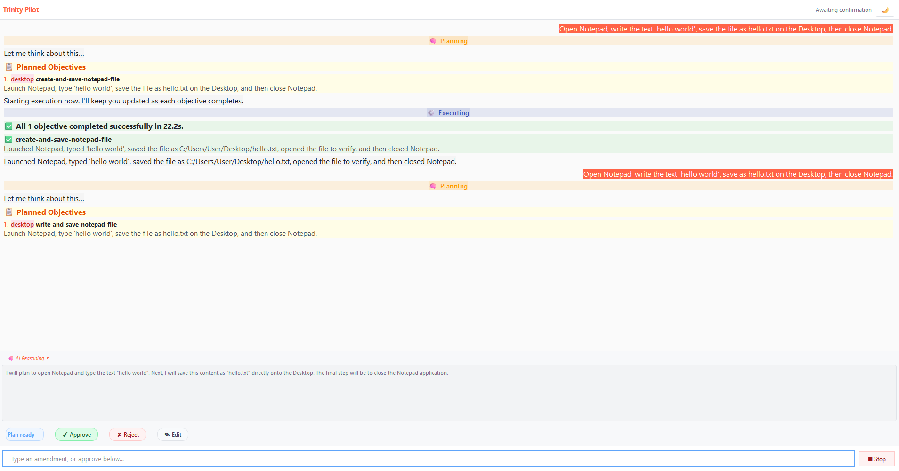
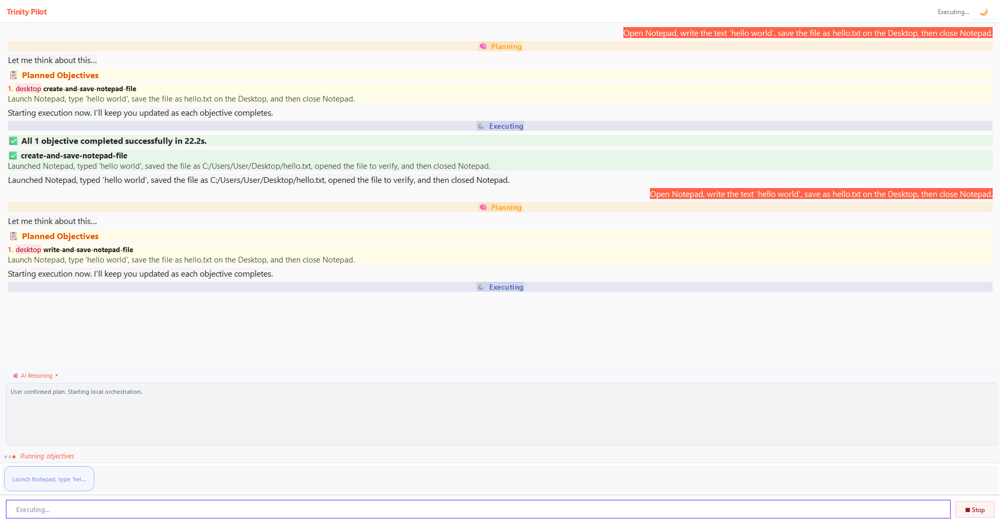
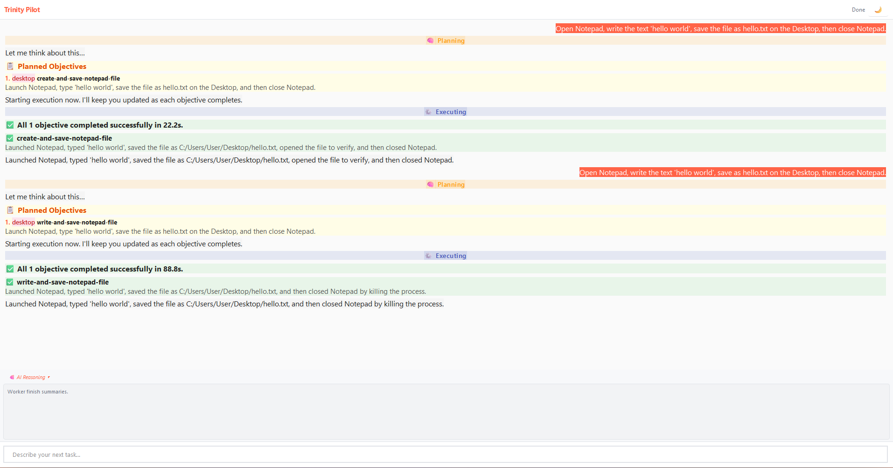
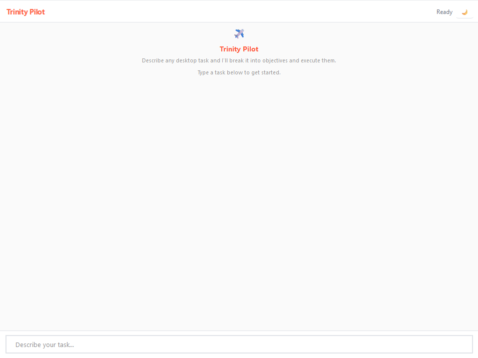

<div align="center">

# Trinity Pilot

### The open-source desktop agent that actually finishes the job.

Type a task in plain English. Trinity Pilot decomposes it into typed objectives, drives your browser, terminal, and desktop apps to execute them, reviews each result with a separate AI pass, and retries on failure — all locally, all async, all on your machine.

[](https://github.com/DurdeuVlad/trinity-pilot/actions/workflows/ci.yml)
[](LICENSE)
[](https://www.python.org/downloads/)
[](#-running-tests)
[](#-safety-and-data-handling)

</div>

---

## Why this exists

Every "AI desktop agent" demo you've seen either:
- **Records a macro** and replays it — breaks the moment a window moves.
- **Calls a single LLM loop** with a screenshot — hallucinates clicks, invents file paths, declares success on failure.
- **Wraps a cloud service** — your screen, files, and terminal output leave your machine.

Trinity Pilot is different. It's a **real orchestration engine** that treats desktop automation as a typed, reviewable, retryable workflow — not a vibe-coding loop. It was built as a bachelor's thesis project and validated against 46 evaluation scenarios across four suites.

<div align="center">

*Trinity Pilot planning and executing a cross-domain task: open a browser, read a page, write the result to a file.*



</div>

---

## What it does

You type something like:

> *"Open a browser, go to example.com, find the page title, and write it to a file on my Desktop."*

Trinity Pilot:

1. **Plans** — An `ObjectivePlanner` (Gemini) decomposes the request into a typed `ObjectiveSpec` DAG with dependencies, domains, risk classes, and success checklists.
2. **Dispatches** — An async orchestrator routes each objective to the right worker: `BrowserWorker` (Playwright), `TerminalWorker` (asyncio subprocess), or `DesktopWorker` (pywinauto UIA).
3. **Executes** — Each worker runs a ReAct loop with real tools: navigate, click, type, read DOM, run commands, drive UI elements. No screenshot-guessing.
4. **Reviews** — A separate `ObjectiveReviewer` (Gemini) examines the evidence (screenshots, stdout, DOM snapshots, file existence) and returns a typed `ReviewResult`: pass, or fail with a specific `FailureReason`.
5. **Retries** — Failed objectives get a recovery hint and retry with the failure context injected into the next attempt. Up to 3 attempts per objective.
6. **Persists** — Every task, attempt, evidence bundle, and reflection is stored in SQLite (WAL mode) for post-hoc analysis.

<div align="center">

### The objective lifecycle


*Each objective moves through a typed state machine. Reviews gate transitions. Budgets bound execution.*

</div>

---

## Architecture

```text
PySide6 UI → WorkflowBridge → AsyncTaskOrchestrator
                                   │
                          ObjectivePlanner (Gemini)
                                   │
                          ObjectiveSpec DAG (typed)
                                   │
              ┌────────────────────┼────────────────────┐
              ▼                    ▼                     ▼
       BrowserWorker       TerminalWorker        DesktopWorker
       (Playwright)        (asyncio exec)        (pywinauto UIA)
              │                    │                     │
              └────────────────────┼────────────────────┘
                                   ▼
                       ObjectiveReviewer (Gemini)
                                   │
                       SQLite WAL state + evidence stores
```

<div align="center">

| Layer | Technology |
|-------|-----------|
| Desktop shell | PySide6 (Qt for Python) |
| Control plane | Local asyncio orchestrator + typed FSM |
| Inner planner | ObjectiveSpec DAG — typed, not prose |
| Capability boundary | FastMCP servers (MCP at boundary, direct calls in hot path) |
| Browser domain | Playwright Python — headful Chromium, dedicated profile |
| Terminal domain | asyncio subprocess — structured commands, not raw shell |
| Desktop-app domain | pywinauto UIA backend → PyAutoGUI fallback |
| Memory/evidence | SQLite — WAL mode, JSON columns, FTS5 |
| LLM provider | Gemini 2.5 Flash (free tier) — swappable via `LLMProvider` ABC |

</div>

### Key architecture diagrams

<div align="center">

| | |
|---|---|
| **Layer architecture** | **Objective sequence** |
|  |  |
| **Worker routing** | **LLM provider abstraction** |
|  |  |

</div>

---

## What's inside

### Typed objectives, not prose

Every objective is a frozen dataclass with 11 required fields — `objective_id`, `goal`, `dependencies`, `domain`, `risk_class`, `preconditions`, `success_tests`, `evidence_bundle`, `max_attempts`, and more. The planner **must** produce all of them or execution is refused.

```python
@dataclass(frozen=True, slots=True)
class ObjectiveSpec:
    objective_id: str
    goal: str
    dependencies: list[str]
    domain: DomainType          # BROWSER | TERMINAL | DESKTOP | MIXED
    risk_class: RiskClass       # LOW | MEDIUM | HIGH
    preconditions: list[str]
    success_tests: list[ChecklistItem]
    evidence_bundle: dict[str, Any]
    max_attempts: int
    # ...
```

### Three real workers, not a screenshot loop

| Worker | Backend | What it does |
|--------|---------|-------------|
| `BrowserWorker` | Playwright | Navigate, click, fill, read DOM, read text, screenshot, inspect network |
| `TerminalWorker` | asyncio subprocess | Run commands, write files, read files — with created-file verification |
| `DesktopWorker` | pywinauto UIA | Launch apps, find windows, click elements, type text, read controls |

Each worker runs a **ReAct loop** — the LLM proposes a tool call, the worker executes it, the result feeds back. No guessing from pixels.

### Separate reviewer with typed failure reasons

The reviewer is a **different agent** with read-only tools. It doesn't trust the worker's self-report — it checks the evidence independently and returns one of:

- `missing_artifact` — expected file/output doesn't exist
- `failed_assertion` — checklist item didn't pass
- `ui_state_mismatch` — UI isn't in the expected state
- `wrong_output` — output exists but content is wrong
- `environment_divergence` — environment changed unexpectedly

### DAG with cross-domain parallelism

Objectives are sorted via Kahn's algorithm. Independent objectives in different domains run **in parallel**. Dependent objectives wait and receive forwarded evidence from their upstream nodes.

### MCP at the boundary

Domain capabilities are exposed as FastMCP servers (browser, terminal, sensor). The orchestrator dispatches through MCP for isolation — but workers call tools directly in the hot path for speed. Sensors (screenshot, OCR, window-list, process-list) are read-only and shared across all agents.

### Three kill paths

1. **In-app stop button** — clean cancellation through the signal bus
2. **Global hotkey** (Ctrl+Shift+Q) — works even if the UI is frozen
3. **PyAutoGUI fail-safe** — slam mouse to screen corner to abort all automation

---

## Evaluation results

Validated against **46 scenarios** across four test suites on a Windows 11 VM:

| Suite | Scenarios | Pass Rate | What it tests |
|-------|-----------|-----------|--------------|
| **Happy Path** | 20 | **95%** | Normal task completion across all three domains |
| **Fail Recovery** | 10 | **67%** | Agent handles missing files, bad URLs, app crashes, focus loss |
| **Resourcefulness** | 10 | **80%** | Agent discovers environment info (disk usage, PIDs, install paths) |
| **Session Continuity** | 6 | **83%** | Agent maintains context across multi-round conversations |

**Highlights:**
- **App crash mid-task: 100%** — agent detects the app is gone and doesn't hang
- **Network unreachable: 100%** — graceful failure, no infinite retry
- **Primary path blocked: 100%** — agent falls back to alternate paths
- **Reference prior result: 100%** — agent correctly uses earlier output in follow-ups

**Test suite:** 475 automated tests (unit + integration + UI), all passing. Ruff clean. Mypy clean across 72 source files.

<div align="center">

### The UI in action


*Trinity Pilot's PySide6 interface: chat input, objective chips, live activity panel, and debug drawer.*

</div>

---

## Quick Start

### Option A: Download Standalone Executable (No Python Setup Required)

1. Download the latest `trinity-pilot-win64.zip` from [Releases](https://github.com/DurdeuVlad/trinity-pilot/releases).
2. Extract the archive and launch `trinity-pilot.exe`.
3. Enter your free Gemini API key in the startup configuration dialog (or set `GEMINI_API_KEY` in environment).

### Option B: Developer Setup with `uv`

```bash
# 1. Clone repository
git clone https://github.com/DurdeuVlad/trinity-pilot.git
cd trinity-pilot

# 2. Sync dependencies
uv sync --extra dev
uv run playwright install chromium

# 3. Launch Trinity Pilot
uv run python -m trinity_pilot
```

If `GEMINI_API_KEY` is not present, Trinity Pilot will open a native setup wizard to save your key to `.env`.

### Get a free Gemini API key

1. Go to [Google AI Studio](https://aistudio.google.com)
2. Create a free API key
3. Paste it into the startup dialog or set `GEMINI_API_KEY` in your environment

The free tier is sufficient for personal use — no billing required.

---

## Example tasks

Trinity Pilot handles cross-domain tasks that span browser, terminal, and desktop:

```
# Browser + Terminal
"Open a browser, go to httpbin.org/uuid, extract the UUID, and save it to a file on my Desktop."

# Terminal only
"Write a Python script that prints the current system info and run it."

# Desktop only
"Open Calculator and compute 17 * 23."

# Cross-domain
"Open Notepad, type today's date, then read it back with a terminal command to verify it saved."
```

<div align="center">

| | |
|---|---|
| **Task input** | **Task executing** |
|  |  |
| **Task complete** | **App startup** |
|  |  |

</div>

---

## Project Layout

```text
trinity_pilot/
  core/types.py          ObjectiveSpec, enums, ReviewResult, AttemptLog
  llm/                   LLMProvider ABC + async GeminiProvider
  planner/               ObjectivePlanner: JSON plan → ObjectiveSpec list + DAG
  reviewer/              ObjectiveReviewer: evidence → typed ReviewResult
  orchestrator/
    engine.py            Local async task orchestration
    fsm.py               Objective state machine
    budget.py            Objective execution budget (steps + tokens + wall clock)
    signals.py           Typed orchestration signals
    analyser.py          Post-task reflection and success analysis
  workers/
    agentic_mixin.py     Shared ReAct loop for all domain workers
    browser_worker.py    Playwright-backed browser automation
    terminal_worker.py   asyncio subprocess terminal automation
    desktop_worker.py    pywinauto UIA desktop automation
  memory/                SQLite WAL: TaskStore, AttemptStore, ReflectionStore, EvidenceStore
  mcp/                   FastMCP boundary servers (browser, terminal, sensor)
  ui/                    PySide6 MainWindow, ApiKeyDialog, WorkflowBridge, ActivityPanel
  telemetry/             Error tracing and finish-reason logging
  audit/                 Preflight checks and recovery drills
  config.py              Settings dataclass + from_env()
  __main__.py            CLI entry with crash hooks (faulthandler + excepthook)
```

---

## Building Standalone Executable

To build a standalone Windows `.exe` release manually:

```bash
uv run python scripts/build_exe.py
```

The resulting standalone executable package is built under `dist/trinity-pilot/`.

---

## Running Tests

```bash
# Run unit, integration, and UI tests (475 tests, ~20s)
uv run pytest tests/unit tests/integration tests/ui -v

# Run test coverage
uv run pytest tests/unit tests/integration --cov=trinity_pilot --cov-report=term-missing

# Lint and type check
uv run ruff check .
uv run mypy trinity_pilot
```

GUI, desktop, and real-model suites require a controlled Windows environment with `GEMINI_API_KEY`. They open real applications and drive the live desktop.

---

## Safety and Data Handling

**Trinity Pilot is not sandboxed.** Terminal workers execute local PowerShell commands with user permissions; browser and desktop workers act directly on the desktop. Review tasks before execution and use a VM or low-privilege account for untrusted work.

When Gemini is configured, task prompts and execution evidence (screenshots, terminal output, UI element text) are sent to Google's Gemini API. No data is stored remotely — all state is local SQLite.

See [SECURITY.md](SECURITY.md) and [docs/PRIVACY_AND_SAFETY.md](docs/PRIVACY_AND_SAFETY.md) for the full safety policy.

---

## Acknowledgements

Trinity Pilot was built as a bachelor's thesis project at [University Politehnica of Bucharest](https://upb.ro/), informed by research on prior desktop automation agents including:

- **UFO/UFO2/UFO3** (Microsoft) — UI automation via UIA tree
- **PC Agent** — desktop task decomposition
- **MobileAgent-v2** — multi-agent mobile automation
- **Agent-S** — self-contained computer use
- **Magentic-UI** — multi-agent browser/desktop orchestration

Full research notes and thesis chapters: [DesktopAI_Research](https://github.com/DurdeuVlad/DesktopAI_Research).

---

## License

[MIT](LICENSE) — do whatever you want, just don't blame me if your desktop agent deletes your files.
