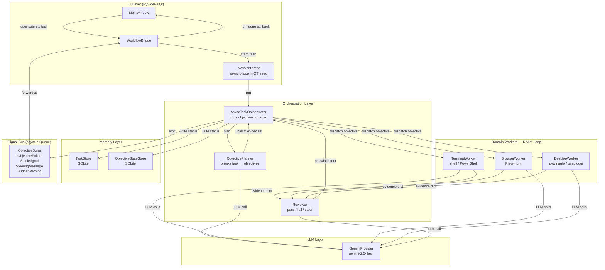
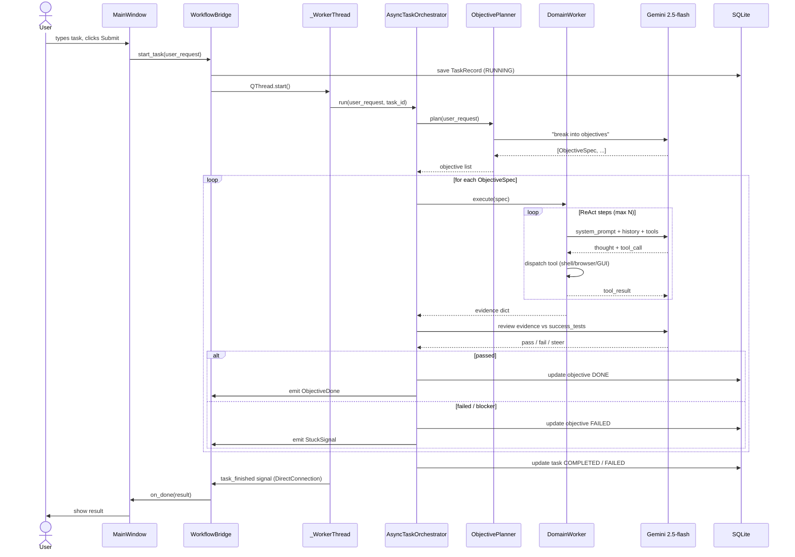
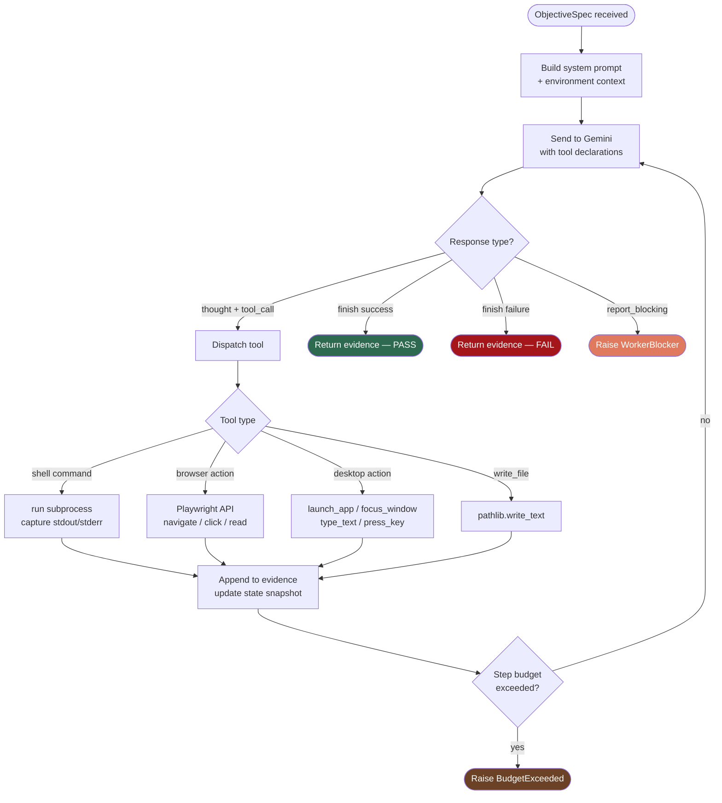
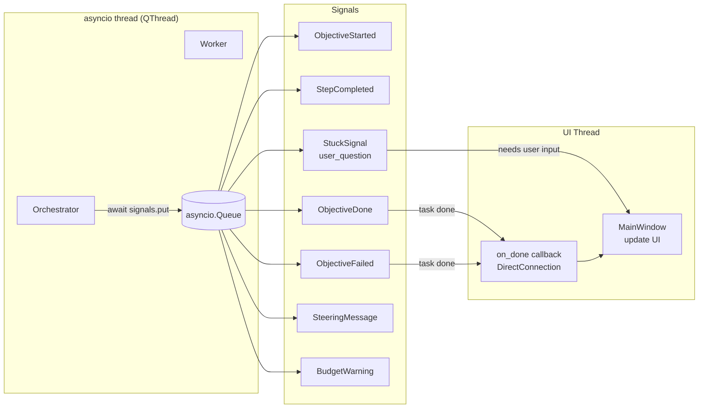
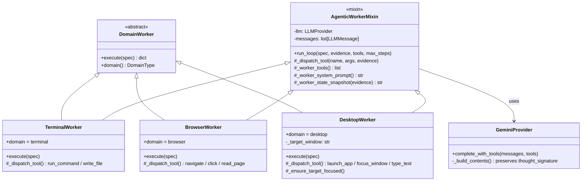
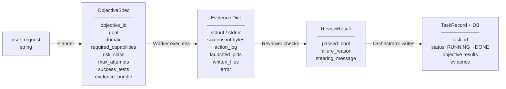

# Trinity Pilot — Architecture Diagrams

---

## 1. System Overview

High-level components and how they connect.

---

## 2. Task Lifecycle — Sequence Diagram

From user click to result shown in UI.

---

## 3. ReAct Loop — Worker Internals

How a single objective is executed inside any domain worker.

---

## 4. Signal Architecture

How the orchestrator communicates status back to the UI without blocking.

---

## 5. Domain Worker Hierarchy

Class relationships.

---

## 6. Data Flow — What Travels Between Components

---

## Key Design Decisions (one-liners for slides)

| Decision | Why |
|---|---|
| ReAct loop per objective | AI reasons before each tool call — self-corrects without scripting every step |
| asyncio + QThread bridge | Non-blocking UI while orchestrator runs; DirectConnection prevents callback deadlock |
| Gemini 2.5-flash (thinking model) | Handles multi-step planning; thought_signature preserved for multi-turn stability |
| Evidence dict pattern | Every worker returns the same shape — Reviewer and tests make uniform assertions |
| Signal bus (asyncio.Queue) | Decouples orchestrator from UI; same queue used in tests for behavioral assertions |
| PID tracking in evidence | Desktop cleanup is precise — no process list scanning, works for any spawned app |
