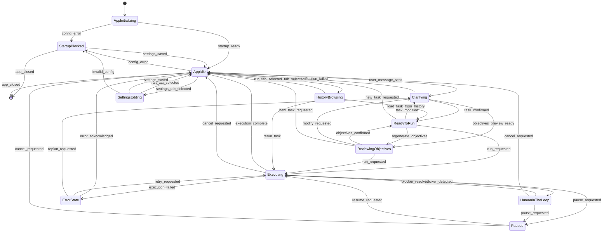
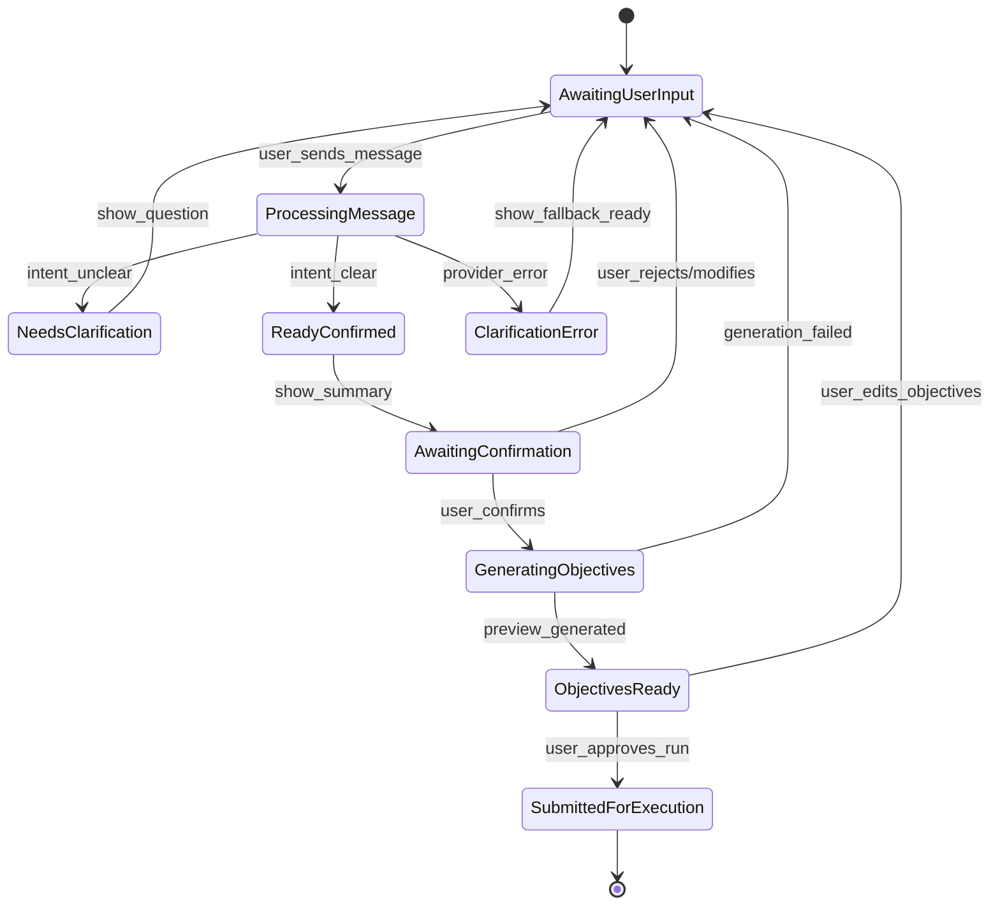
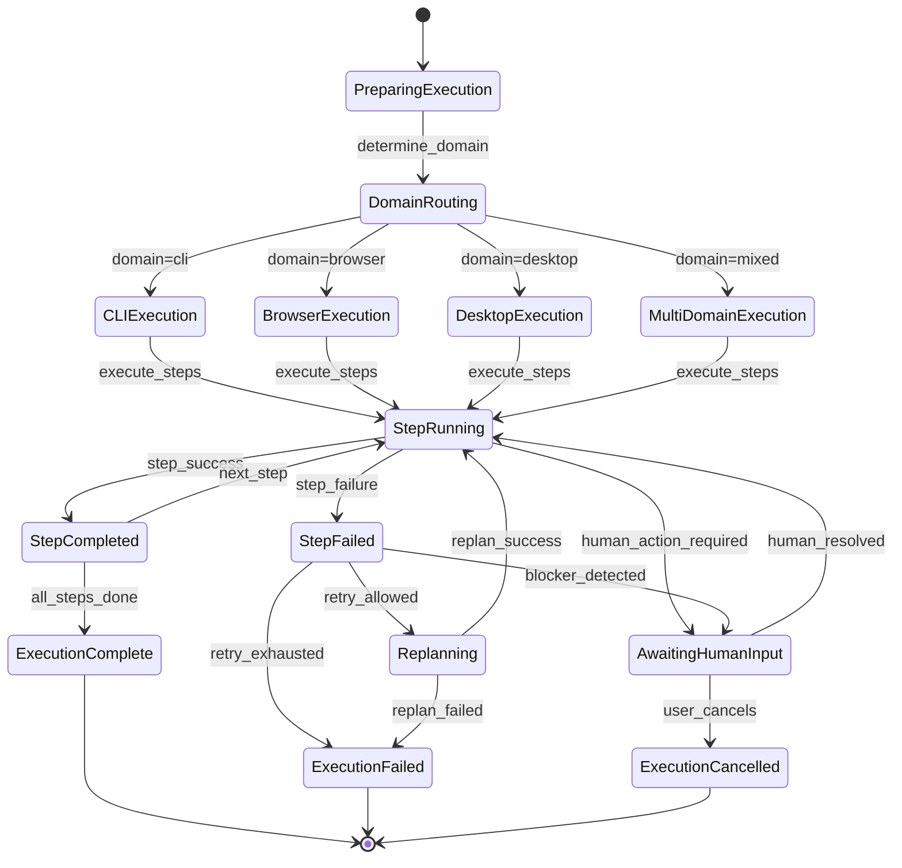
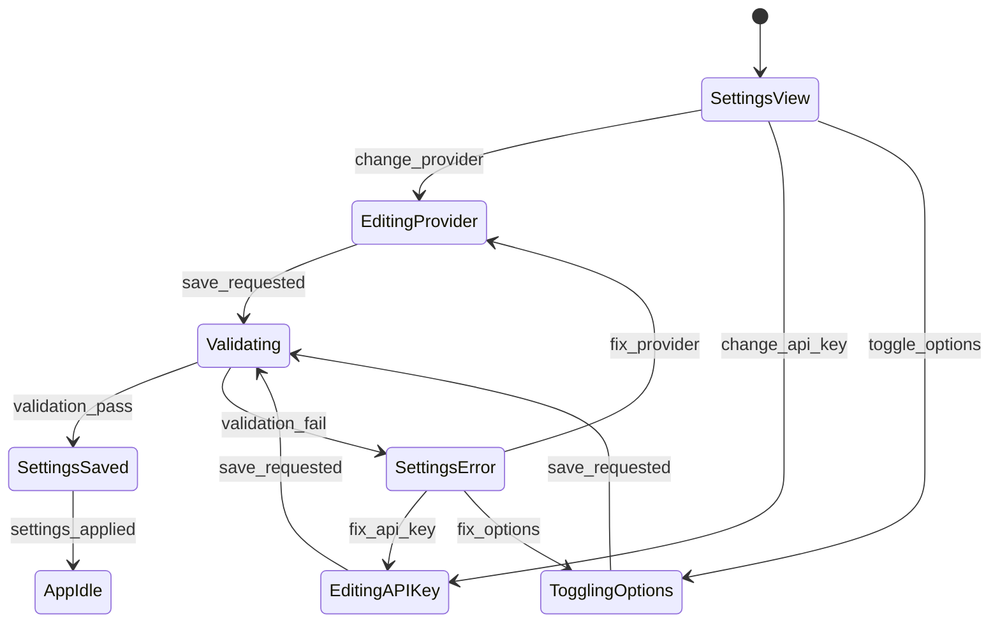
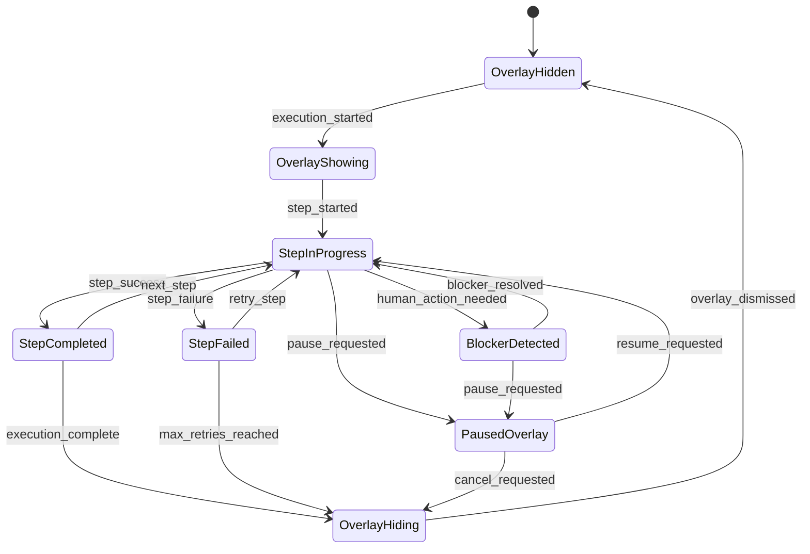
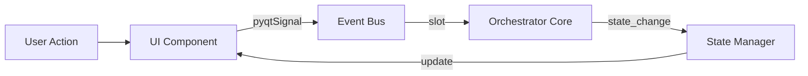
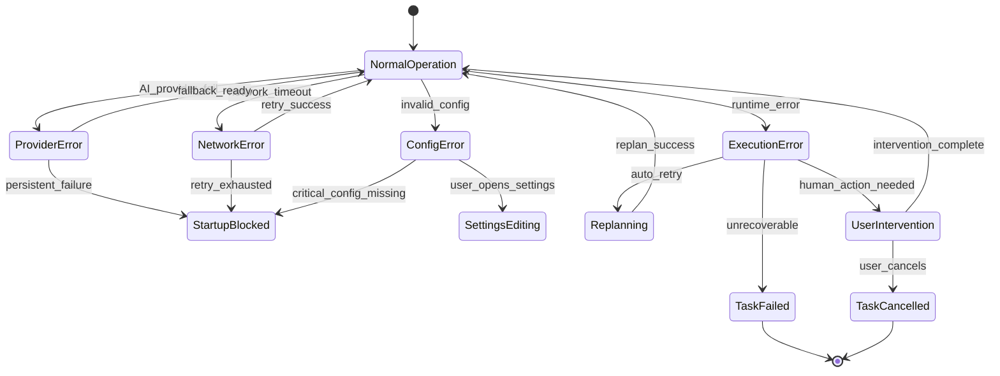

# Trinity Pilot Unified App - User Flows State Machine

## Overview

This document maps all possible user flows in the Trinity Pilot Unified App as a **closed state machine**. The state machine captures every state a user can be in, and all valid transitions between states.

## Architecture Context

```
User -> Trinity Unified Desktop -> finalized objective + selected MCP target -> Trinity Core -> visible MCP tools
```

The Unified App owns:
- PyQt6 desktop UI
- Clarification and conversation state
- Objective preview generation and editing
- Final objective confirmation
- Target selection and Desktop -> Core handoff
- Execution status display and local history

## Global State Machine



## Detailed State Definitions

### Application States

| State | Description | Entry Actions | Exit Actions |
|-------|-------------|---------------|--------------|
| **AppInitializing** | App is starting up, loading config, running preflight checks | Load settings, probe AI providers, check Trinity Core health | - |
| **StartupBlocked** | Cannot proceed due to missing/invalid configuration | Display blocking message in chat panel | - |
| **AppIdle** | Ready for user input, waiting for task description | Enable input field, clear previous state | - |

### Clarification States

| State | Description | Entry Actions | Exit Actions |
|-------|-------------|---------------|--------------|
| **Clarifying** | Engaged in back-and-forth to clarify user intent | Show thinking indicator, disable input temporarily | - |
| **ReadyToRun** | Task is confirmed, ready for execution | Show "Run" button, enable objective editing | - |
| **ReviewingObjectives** | Objectives preview displayed for user approval | Show objective editor widget | - |

### Execution States

| State | Description | Entry Actions | Exit Actions |
|-------|-------------|---------------|--------------|
| **Executing** | Task is being executed by Trinity Core | Show execution overlay, minimize main window (if desktop/browser domain) | Restore main window |
| **Paused** | Execution paused at user request | Show paused overlay, restore main window | - |
| **HumanInTheLoop** | Waiting for human action (CAPTCHA, confirmation) | Show blocker overlay with instructions | - |
| **ErrorState** | Execution failed with error | Show error details, offer retry/replan options | - |

### Navigation States

| State | Description | Entry Actions | Exit Actions |
|-------|-------------|---------------|--------------|
| **HistoryBrowsing** | Viewing task history tab | Load history from database | - |
| **SettingsEditing** | Viewing/editing settings tab | Load current settings | Save settings |

## Sub-State Machines

### 1. Clarification Flow State Machine



### 2. Execution Flow State Machine



### 3. History Interaction State Machine

```mmdb
stateDiagram-v2
    [*] --> HistoryListView
    
    HistoryListView --> Filtering : apply_filters
    HistoryListView --> TaskSelected : user_selects_task
    HistoryListView --> Importing : import_requested
    
    Filtering --> HistoryListView : filters_applied
    
    TaskSelected --> TaskDetailView : show_details
    
    TaskDetailView --> HistoryListView : back_to_list
    TaskDetailView --> RunTabWithTask : load_into_chat
    TaskDetailView --> Executing : rerun_task
    TaskDetailView --> Exporting : export_selected
    
    Importing --> HistoryListView : import_complete
    
    Exporting --> TaskDetailView : export_complete
    
    RunTabWithTask --> [*]
```

### 4. Settings Management State Machine



### 5. Overlay Control State Machine (During Execution)



## Event-Driven Transitions

The state machine is driven by events emitted via the EventBus:



### Key Events by Category

**Chat & Clarification:**
- `chat_message(role, text)` - Add message to chat
- `clarification_ready(confirmed_task)` - Task is clarified and ready
- `objectives_preview_ready(task, objectives)` - Objectives generated
- `objectives_modify_done(success)` - Objectives modification complete

**Task Execution:**
- `task_submitted(description, domain)` - User submitted task
- `plan_generated(steps)` - Execution plan created
- `step_started(index, description)` - Step execution started
- `step_completed(index, payload)` - Step completed successfully
- `step_failed(index, error)` - Step failed
- `execution_complete(payload)` - Full execution complete
- `execution_started()` - Execution beginning
- `execution_ended()` - Execution finished

**Control Signals:**
- `task_cancel_requested()` - User requested cancellation
- `steer_input(text)` - User provided mid-run guidance
- `blocker_detected(message)` - Human action required
- `blocker_resolved()` - Human action completed

**System:**
- `preflight_done(readiness)` - Startup preflight complete
- `app_busy(busy)` - App busy state changed
- `desktop_takeover_started(domain)` - Desktop/browser takeover
- `desktop_takeover_ended()` - Takeover complete

## Error Handling Flows



## State Transition Table

| From State | Event | To State | Condition |
|------------|-------|----------|-----------|
| AppInitializing | preflight_success | AppIdle | - |
| AppInitializing | preflight_fail | StartupBlocked | - |
| StartupBlocked | settings_saved | AppIdle | config_valid |
| AppIdle | user_message | Clarifying | - |
| Clarifying | clarification_success | ReadyToRun | - |
| Clarifying | clarification_fail | AppIdle | - |
| ReadyToRun | run_requested | Executing | - |
| ReadyToRun | regenerate_requested | ReviewingObjectives | - |
| ReviewingObjectives | run_requested | Executing | - |
| ReviewingObjectives | modify_requested | Clarifying | - |
| Executing | execution_complete | AppIdle | - |
| Executing | pause_requested | Paused | - |
| Executing | blocker_detected | HumanInTheLoop | - |
| Executing | cancel_requested | AppIdle | - |
| Paused | resume_requested | Executing | - |
| HumanInTheLoop | blocker_resolved | Executing | - |
| AppIdle | history_selected | HistoryBrowsing | - |
| HistoryBrowsing | load_task | ReadyToRun | - |
| AppIdle | settings_selected | SettingsEditing | - |
| SettingsEditing | settings_saved | AppIdle | valid |

## Terminal States

The following states can only transition to a terminal condition:

- **ExecutionFailed** - Can transition to AppIdle (acknowledge) or Executing (retry)
- **TaskCancelled** - Transitions to AppIdle
- **AppClosed** - Terminal state

## Entry Points & Exit Conditions

**Entry Points:**
1. Application launch → `AppInitializing`
2. Task pipe submission → `ReadyToRun` or `AppIdle`
3. History rerun → `Executing`

**Exit Conditions:**
1. User closes window → `AppClosed`
2. Shutdown command from pipe → `AppClosed`
3. Fatal error → `AppClosed`

## Visual State Representation

### Chat Panel States

```
┌─────────────────────────────────────────┐
│  IDLE        THINKING    READY_TO_RUN   │
│  ┌─────┐     ┌─────┐     ┌─────────┐   │
│  │input│     │●●● │     │[Run]    │   │
│  └─────┘     └─────┘     │[Edit]   │   │
│                          └─────────┘   │
├─────────────────────────────────────────┤
│  REVIEWING_OBJS    EXECUTING           │
│  ┌────────────┐    ┌────────────┐      │
│  │obj1 [✓]    │    │  OVERLAY   │      │
│  │obj2 [✓]    │    │  ACTIVE    │      │
│  │[Run] [Edit]│    │  ▶ Step 2  │      │
│  └────────────┘    └────────────┘      │
└─────────────────────────────────────────┘
```

## Appendix: EventBus Signal Reference

```python
# Task lifecycle
task_submitted = pyqtSignal(str, str)           # description, domain
pipe_task_submitted = pyqtSignal(str, str, str) # description, domain, request_id
steer_input = pyqtSignal(str)                    # guidance text
task_cancel_requested = pyqtSignal()
task_policy_stop_requested = pyqtSignal(str)

# Plan & execution
plan_generated = pyqtSignal(list)                # steps
step_started = pyqtSignal(int, str)              # index, description
step_completed = pyqtSignal(int, dict)           # index, payload
step_failed = pyqtSignal(int, object)            # index, error
step_detail = pyqtSignal(int, int, str, str)     # obj_idx, step_num, action, result
plan_state_updated = pyqtSignal(int, dict)       # index, state
status_update = pyqtSignal(str, str)             # message, level
cli_step_progress = pyqtSignal(int, dict)        # obj_index, step_payload

# Execution state
execution_complete = pyqtSignal(dict)            # payload
app_busy = pyqtSignal(bool)                      # busy state
execution_started = pyqtSignal()
execution_ended = pyqtSignal()
run_started = pyqtSignal(str)                    # run_id
run_ended = pyqtSignal(str)                      # run_id

# System control
command_reset_requested = pyqtSignal()
command_shutdown_requested = pyqtSignal()
desktop_takeover_started = pyqtSignal(str)       # domain
desktop_takeover_ended = pyqtSignal()
preflight_done = pyqtSignal(object)              # StartupReadiness

# Chat & clarification
chat_message = pyqtSignal(str, str)              # role, text
clarification_ready = pyqtSignal(str)            # confirmed task
objectives_preview_ready = pyqtSignal(str, list) # task, objectives
objectives_modify_done = pyqtSignal(bool)        # success
task_result_ready = pyqtSignal(str, dict)        # answer, summary

# Human-in-the-loop
blocker_detected = pyqtSignal(str)               # message
blocker_resolved = pyqtSignal()
```

---

*Generated for Trinity Pilot Unified App - Desktop orchestration layer*
