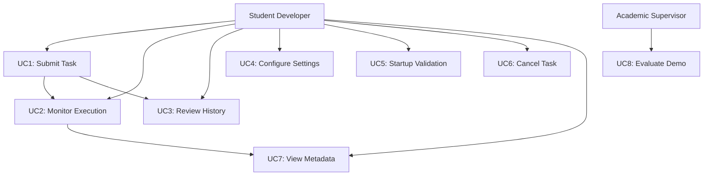

# Use Cases - Orchestrator Desktop App

**Project:** unified-app  
**Document ID:** USR-003  
**Last Updated:** 2026-03-14  
**Status:** Active

---

## 1. Purpose

This document defines detailed use cases for the Orchestrator Desktop App, specifying preconditions, main flows, alternative flows, and postconditions for each user interaction.

---

## 2. Use Case Template

Each use case follows this structure:
- **UC ID:** Unique identifier
- **Name:** Descriptive name
- **Actor:** Primary user
- **Preconditions:** What must be true before
- **Trigger:** What initiates the use case
- **Main Flow:** Normal path steps
- **Alternative Flows:** Variations and exceptions
- **Postconditions:** What's true after success
- **Related Requirements:** Traceability to requirements

---

## 3. Primary Use Cases

### UC1: Submit and Execute Task

**UC ID:** UC-001  
**Name:** Submit Natural Language Task for Execution  
**Actor:** Student Developer  
**Priority:** Critical

**Preconditions:**
- Application is running
- User is on Run tab
- No task currently executing
- Startup checks passed (or mock mode active)

**Trigger:** User enters task description and clicks "Run Task"

**Main Flow:**
1. User enters task description in text input
2. User selects domain (or leaves as auto-detect)
3. User clicks "Run Task" button
4. System validates input (non-empty, reasonable length)
5. System emits task_submitted event
6. System disables submit button, shows "Executing..." state
7. Orchestrator generates execution plan via MacroPlanner
8. System displays plan in execution plan panel
9. Orchestrator executes each step sequentially
10. System updates step status (running → completed/failed)
11. System logs status messages in real-time
12. System captures and displays screenshots if available
13. Execution completes successfully
14. System saves task to history database
15. System re-enables submit button
16. System shows completion message

**Alternative Flows:**

**A1: Empty Task Description**
- At step 4: System shows validation error "Task description cannot be empty"
- Use case ends, user can retry

**A2: Task Already Executing**
- At step 3: Submit button is disabled
- System shows message "Task already in progress"
- Use case ends

**A3: Execution Fails**
- At step 9-12: Step execution fails
- System marks step as failed in plan
- System logs error message with details
- System stops execution
- System saves failed task to history
- System re-enables submit button
- Use case ends

**A4: User Cancels Task**
- At any point during execution: User clicks "Cancel"
- System stops orchestrator gracefully
- System logs cancellation message
- System marks task as cancelled in history
- System re-enables submit button
- Use case ends

**A5: API Unavailable (Live Mode)**
- At step 7: MacroPlanner cannot reach Gemini API
- System shows error message
- System suggests switching to mock mode
- Use case ends, user can configure settings

**Postconditions:**
- Task is recorded in history database
- UI returns to ready state
- User can submit next task

**Related Requirements:** FR1.1, FR1.2, FR1.4, FR2.1, FR2.2, FR3.1, FR4.1

---

### UC2: Monitor Task Execution

**UC ID:** UC-002  
**Name:** Monitor Real-Time Task Execution  
**Actor:** Student Developer  
**Priority:** Critical

**Preconditions:**
- Task execution is in progress (UC-001 steps 7-13)

**Trigger:** Task execution starts

**Main Flow:**
1. System displays execution plan with numbered steps
2. System highlights current step being executed
3. System appends status messages to log panel
4. System auto-scrolls log to latest message
5. Backend captures screenshot
6. System detects new screenshot file
7. System loads and displays screenshot in glass box panel
8. System analyzes screenshot metadata
9. System updates metadata display (dimensions, size, FPS)
10. Execution progresses to next step
11. System updates previous step status to "completed"
12. Steps 2-11 repeat for each plan step
13. All steps complete
14. System shows final status message

**Alternative Flows:**

**A1: No Screenshots Available**
- At step 5-6: No screenshot captured
- System shows placeholder or previous screenshot
- Metadata shows "No frame available"
- Use case continues

**A2: Screenshot Load Fails**
- At step 7: Image file corrupted or unreadable
- System logs warning
- System shows error placeholder
- Use case continues

**A3: Step Execution Slow**
- At step 2: Step takes longer than expected
- System continues showing "running" status
- User can still cancel if needed
- Use case continues

**Postconditions:**
- User has visibility into execution progress
- All status messages are logged
- Screenshots are displayed when available

**Related Requirements:** FR2.2, FR2.3, FR3.1, FR3.2, FR3.3

---

### UC3: Review Task History

**UC ID:** UC-003  
**Name:** Review Past Task Executions  
**Actor:** Student Developer  
**Priority:** High

**Preconditions:**
- Application is running
- At least one task has been executed previously

**Trigger:** User clicks "History" tab

**Main Flow:**
1. User switches to History tab
2. System queries history database
3. System loads all task records
4. System displays tasks in table (description, status, timestamp)
5. System sorts by most recent first
6. User scrolls through history
7. User double-clicks a task row
8. System retrieves full task details
9. System displays details dialog with:
   - Full task description
   - Execution plan
   - Outcome (success/failure/cancelled)
   - Start and end timestamps
10. User reviews details
11. User closes dialog

**Alternative Flows:**

**A1: Empty History**
- At step 3: No tasks in database
- System shows "No tasks in history" message
- Use case ends

**A2: Search History**
- At step 6: User enters search term
- System filters tasks by description
- System updates table with matching tasks only
- User can clear search to show all
- Use case continues

**A3: Database Error**
- At step 2: Database connection fails
- System shows error message
- System logs error details
- Use case ends

**A4: Large History**
- At step 3: Many tasks in database (>1000)
- System loads efficiently (pagination or lazy loading)
- UI remains responsive
- Use case continues

**Postconditions:**
- User has reviewed past executions
- History data remains unchanged
- UI returns to ready state

**Related Requirements:** FR4.1, FR4.2, FR4.3, FR4.4

---

### UC4: Configure Application Settings

**UC ID:** UC-004  
**Name:** Configure API Key and Settings  
**Actor:** Student Developer  
**Priority:** High

**Preconditions:**
- Application is running

**Trigger:** User clicks "Settings" tab

**Main Flow:**
1. User switches to Settings tab
2. System displays current settings
3. User enters/updates Gemini API key (masked input)
4. User adjusts timeout value (seconds)
5. User adjusts retry count
6. User sets domain default
7. User sets frame capture limits
8. User clicks "Save Settings"
9. System validates all inputs
10. System persists settings to configuration
11. System shows "Settings saved successfully" message
12. Settings take effect immediately

**Alternative Flows:**

**A1: Invalid Timeout Value**
- At step 9: Timeout is negative or too large
- System shows validation error
- User corrects value
- Use case continues from step 8

**A2: Invalid Retry Count**
- At step 9: Retry count is negative
- System shows validation error
- User corrects value
- Use case continues from step 8

**A3: Cancel Without Saving**
- At any point: User switches tabs without saving
- System discards unsaved changes
- Settings remain unchanged
- Use case ends

**A4: Test API Key**
- After step 3: User clicks "Test Connection"
- System attempts API call with new key
- System shows success or failure message
- User can proceed to save or correct
- Use case continues

**Postconditions:**
- Settings are persisted
- New settings are active
- User can submit tasks with new configuration

**Related Requirements:** FR5.1, FR5.2, FR5.3, FR5.4, FR5.5, FR5.6

---

### UC5: Handle Startup Validation

**UC ID:** UC-005  
**Name:** Validate Configuration on Startup  
**Actor:** Student Developer  
**Priority:** High

**Preconditions:**
- User launches application
- Configuration files exist

**Trigger:** Application main() executes

**Main Flow:**
1. System loads module-local .env file
2. System detects GEMINI_MOCK environment variable
3. GEMINI_MOCK=1 detected (mock mode)
4. System activates mock mode
5. System shows "Startup mode: mock fallback ready" message
6. System enables task submission
7. Application window displays
8. User can submit tasks

**Alternative Flows:**

**A1: Live Mode with Valid API Key**
- At step 3: GEMINI_MOCK not set, API key present
- System runs startup preflight checks
- System tests MacroPlanner connectivity (8s timeout)
- System tests CLI planner connectivity (8s timeout)
- Both tests pass
- System shows "Startup mode: live Gemini ready" message
- System enables task submission
- Use case continues from step 7

**A2: Live Mode with Invalid API Key**
- At A1 step 3-4: Preflight checks fail (invalid key)
- System shows "Live Gemini blocked: invalid API key" message
- System disables task submission
- User must configure valid key or switch to mock mode
- Use case ends with blocked state

**A3: Live Mode with Network Failure**
- At A1 step 3-4: Preflight checks timeout
- System shows "Live Gemini blocked: startup preflight timed out" message
- System suggests switching to mock mode
- System disables task submission
- Use case ends with blocked state

**A4: Live Mode with Quota Exhausted**
- At A1 step 3-4: Preflight checks fail (quota/rate limit)
- System shows "Live Gemini blocked: quota or rate limit reached" message
- System suggests switching to mock mode
- System disables task submission
- Use case ends with blocked state

**A5: Missing API Key in Live Mode**
- At step 3: GEMINI_MOCK not set, no API key
- System shows "Live Gemini blocked: GEMINI_API_KEY missing" message
- System disables task submission
- User must set key or enable mock mode
- Use case ends with blocked state

**Postconditions:**
- Startup mode is determined (live or mock)
- Task submission is enabled or blocked appropriately
- User sees clear status message
- Application is ready for use (if not blocked)

**Related Requirements:** FR6.1, FR6.2, FR6.3, FR6.4, FR6.5, FR6.6

---

## 4. Secondary Use Cases

### UC6: Cancel Running Task

**UC ID:** UC-006  
**Name:** Cancel Task During Execution  
**Actor:** Student Developer  
**Priority:** Medium

**Preconditions:**
- Task is currently executing

**Trigger:** User clicks "Cancel" button

**Main Flow:**
1. User clicks "Cancel" button during execution
2. System emits task_cancel_requested event
3. Orchestrator receives cancellation signal
4. Orchestrator stops current step gracefully
5. System marks task as "cancelled" in history
6. System logs "Task cancelled by user" message
7. System re-enables submit button
8. UI returns to ready state

**Postconditions:**
- Task execution is stopped
- History shows cancelled status
- UI is ready for next task

**Related Requirements:** FR1.3

---

### UC7: View Screenshot Metadata

**UC ID:** UC-007  
**Name:** View Frame Metadata During Execution  
**Actor:** Student Developer  
**Priority:** Low

**Preconditions:**
- Task is executing
- Screenshot has been captured

**Trigger:** New screenshot appears in glass box panel

**Main Flow:**
1. System detects new screenshot file
2. System calls FrameAnalyzer.analyze(path)
3. Analyzer extracts width, height, file size
4. System calculates FPS from frame timestamps
5. System updates metadata display in glass box panel
6. User views metadata alongside screenshot

**Postconditions:**
- Metadata is displayed
- User has visibility into frame characteristics

**Related Requirements:** FR3.3

---

## 5. Use Case Diagram

---

## 6. Use Case Priority Matrix

| Use Case | Priority | Complexity | Status |
|----------|----------|------------|--------|
| UC1: Submit Task | Critical | High | ✅ Implemented |
| UC2: Monitor Execution | Critical | High | ✅ Implemented |
| UC3: Review History | High | Medium | ✅ Implemented |
| UC4: Configure Settings | High | Medium | ✅ Implemented |
| UC5: Startup Validation | High | High | ✅ Implemented |
| UC6: Cancel Task | Medium | Low | ✅ Implemented |
| UC7: View Metadata | Low | Low | ✅ Implemented |

---

## 7. Traceability to Requirements

| Use Case | Functional Requirements | User Stories |
|----------|------------------------|--------------|
| UC1 | FR1.1, FR1.2, FR1.4, FR2.1, FR2.2, FR3.1, FR4.1 | US1.1, US1.2, US2.1, US2.2 |
| UC2 | FR2.2, FR2.3, FR3.1, FR3.2, FR3.3 | US2.1, US2.2, US2.3, US2.4 |
| UC3 | FR4.1, FR4.2, FR4.3, FR4.4 | US3.1, US3.2, US3.3, US3.4 |
| UC4 | FR5.1, FR5.2, FR5.3, FR5.4, FR5.5, FR5.6 | US4.1, US4.2, US4.3, US4.4 |
| UC5 | FR6.1, FR6.2, FR6.3, FR6.4, FR6.5, FR6.6 | US5.3 |
| UC6 | FR1.3 | US1.2 |
| UC7 | FR3.3 | US2.3 |

---

## References

- User Personas: `user-personas.md`
- User Stories: `user-stories.md`
- User Journey Maps: `user-journey-maps.md`
- Functional Requirements: `../03-functional/functional-requirements.md`
