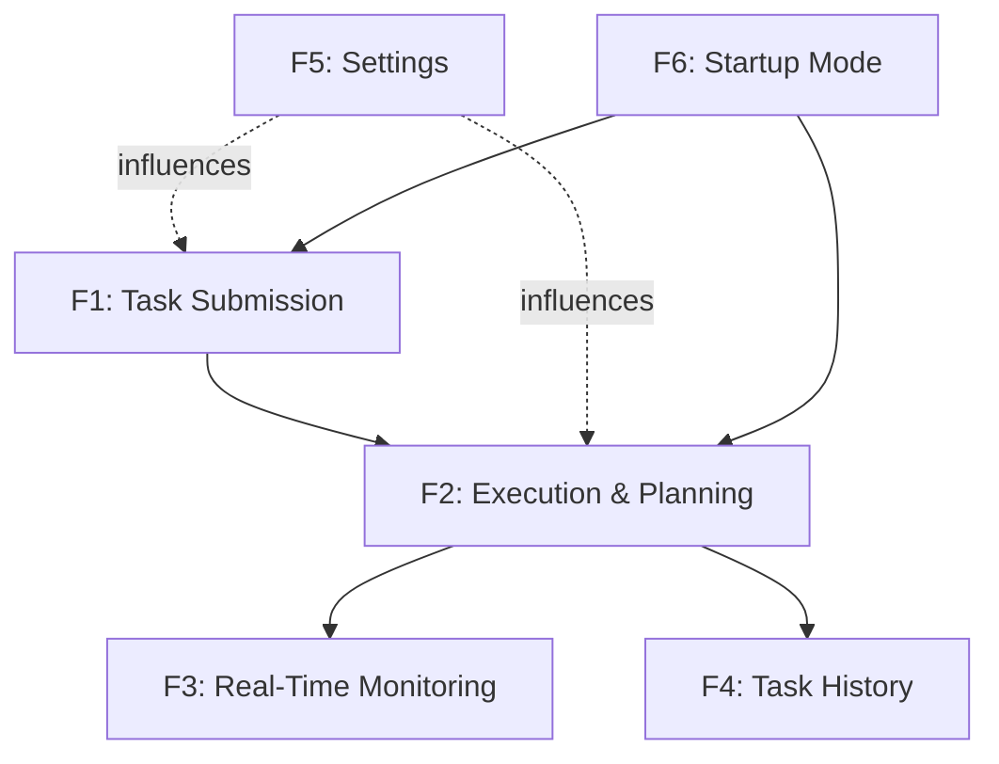

# Feature Specifications - Orchestrator Desktop App

**Project:** unified-app  
**Document ID:** FUN-002  
**Last Updated:** 2026-03-14  
**Status:** Active

---

## 1. Purpose

This document provides detailed specifications for each major feature of the Orchestrator Desktop App, including inputs, outputs, processing logic, and edge cases.

---

## 2. Feature Template

Each feature specification includes:
- **Feature ID:** Unique identifier
- **Name:** Feature name
- **Description:** What the feature does
- **User Stories:** Related user stories
- **Functional Requirements:** Related FRs
- **Inputs:** What data enters the feature
- **Processing:** How the feature works
- **Outputs:** What the feature produces
- **Edge Cases:** Boundary conditions and exceptions
- **Dependencies:** Other features required
- **UI Components:** UI elements involved
- **Status:** Implementation status

---

## 3. F1: Task Submission

**Feature ID:** F-001  
**Name:** Natural Language Task Submission  
**Description:** Allows users to submit task descriptions in natural language and execute them through the orchestrator

**User Stories:** US1.1, US1.2, US1.3  
**Functional Requirements:** FR1.1, FR1.2, FR1.4, FR1.5

### Inputs
- **Task Description** (string, 1-1000 characters): Natural language description of desired task
- **Domain Selection** (enum): Auto-detect | Browser | Desktop
- **User Action**: Click "Run Task" button

### Processing
1. User enters task description in text input field
2. User selects domain from dropdown (default: Auto-detect)
3. User clicks "Run Task" button
4. System validates input:
   - Check non-empty (min 1 character)
   - Check max length (1000 characters)
   - If invalid: show error, abort
5. System emits `task_submitted` event with task data
6. System disables submit button, enables cancel button
7. System updates UI state to "Executing..."
8. Orchestrator receives task and begins execution (see F2)

### Outputs
- **Event**: `task_submitted(task_description, domain)`
- **UI State**: Submit button disabled, Cancel button enabled
- **Status Message**: "Task submitted: [description]"

### Edge Cases
- **Empty input**: Show validation error "Task description cannot be empty"
- **Too long input**: Truncate or show error "Maximum 1000 characters"
- **Task already running**: Disable submit button, show "Task in progress"
- **Special characters**: Accept all UTF-8, sanitize for display
- **Whitespace-only**: Treat as empty, show validation error

### Dependencies
- Event bus must be initialized
- Orchestrator must be ready

### UI Components
- `TaskInputPanel` - text input, domain dropdown, submit/cancel buttons
- `StatusLogPanel` - displays submission confirmation

### Status
✅ Implemented in Sprint 1

**Implementation Files:**
- `ui/panels/task_input_panel.py`
- `orchestrator/event_bus.py`

**Tests:**
- `tests/ui/test_task_input_panel.py`
- `tests/integration/test_task_submission.py`

---

## 4. F2: Execution Planning and Orchestration

**Feature ID:** F-002  
**Name:** Task Execution with Plan Generation  
**Description:** Generates execution plan from task description and executes each step sequentially

**User Stories:** US2.1, US2.2, US2.4  
**Functional Requirements:** FR1.4, FR2.1, FR2.2, FR2.3, FR2.4

### Inputs
- **Task Description** (string): From F1 task submission
- **Domain** (enum): From F1 domain selection
- **API Key** (string, optional): From settings or environment
- **Mock Mode** (boolean): From environment variable

### Processing
1. Orchestrator receives `task_submitted` event
2. System determines planning mode:
   - If `GEMINI_MOCK=1`: Use mock planner
   - Else if API key present: Use MacroPlanner with Gemini
   - Else: Error (blocked by startup checks)
3. MacroPlanner generates execution plan:
   - Sends task description to Gemini API (or mock)
   - Receives structured plan with numbered steps
   - Validates plan structure
4. System emits `plan_generated` event with plan data
5. UI displays plan in ExecutionPlanPanel
6. Orchestrator executes each step sequentially:
   - Emit `step_started(index, description)`
   - Execute step via TrinityBridge
   - On success: emit `step_completed(index, result)`
   - On failure: emit `step_failed(index, error)`, stop execution
7. After all steps: emit `execution_complete(result)`
8. System saves task to history database

### Outputs
- **Events**: 
  - `plan_generated(plan: List[str])`
  - `step_started(index: int, description: str)`
  - `step_completed(index: int, result: dict)`
  - `step_failed(index: int, error: str)`
  - `execution_complete(result: dict)`
- **UI Updates**: Plan display, step status indicators
- **Database Record**: Task saved to history
- **Status Messages**: Progress logged to status panel

### Edge Cases
- **API unavailable**: Fall back to mock mode, log warning
- **Invalid plan format**: Retry with simplified prompt or use fallback
- **Step execution timeout**: Mark step as failed, stop execution
- **Network interruption**: Retry step up to configured retry count
- **Empty plan**: Show error "Could not generate plan"
- **Cancellation during execution**: Stop gracefully, mark as cancelled

### Dependencies
- F1 (Task Submission) must complete first
- MacroPlanner or mock planner must be available
- TrinityBridge must be initialized
- Event bus must be operational

### UI Components
- `ExecutionPlanPanel` - displays plan and step status
- `StatusLogPanel` - logs execution progress
- `GlassBoxPanel` - shows screenshots during execution

### Status
✅ Implemented in Sprint 1

**Implementation Files:**
- `orchestrator/orchestrator_core.py`
- `orchestrator/macro_planner.py`
- `orchestrator/trinity_bridge.py`
- `testing/gemini_mock/` (mock mode)

**Tests:**
- `tests/integration/test_full_loop_integration.py`
- `tests/unit/test_macro_planner.py`
- `tests/unit/test_orchestrator_core.py`

---

## 5. F3: Real-Time Execution Monitoring

**Feature ID:** F-003  
**Name:** Glass Box View with Screenshot Display  
**Description:** Displays real-time screenshots and metadata from backend execution

**User Stories:** US2.3  
**Functional Requirements:** FR3.2, FR3.3

### Inputs
- **Screenshot Files**: JPEG files in `_runtime/screenshots/`
- **File Naming Pattern**: `screenshot_{domain}-obj-{timestamp}_{stage}.jpg`
- **File System Events**: New file creation notifications

### Processing
1. ScreenshotWatcher monitors `_runtime/screenshots/` directory
2. On new file detected:
   - Emit `frame_captured(file_path: str)` event
3. GlassBoxPanel receives event:
   - Load image from file path
   - Display in QLabel with scaling
   - Handle load errors gracefully
4. FrameAnalyzer analyzes screenshot:
   - Extract image dimensions (width, height)
   - Get file size in bytes
   - Calculate FPS from timestamp differences
5. GlassBoxPanel updates metadata display:
   - Show dimensions, size, FPS
   - Format for readability

### Outputs
- **UI Display**: Screenshot image in glass box panel
- **Metadata Display**: Width, height, size, FPS
- **Event**: `frame_captured(file_path)`
- **Event**: `frame_rate_updated(fps)`

### Edge Cases
- **No screenshots**: Show placeholder "No frame available"
- **Corrupted image**: Show error placeholder, log warning
- **Missing file**: Handle FileNotFoundError, show previous frame
- **Very large image**: Scale to fit panel, maintain aspect ratio
- **Rapid frames**: Throttle updates to prevent UI lag
- **Directory doesn't exist**: Create directory, continue monitoring

### Dependencies
- F2 (Execution) must be running
- Backend adapters must write screenshots
- File system access required

### UI Components
- `GlassBoxPanel` - image display and metadata
- `ScreenshotWatcher` - file system monitoring
- `FrameAnalyzer` - metadata extraction

### Status
✅ Implemented in Sprint 2

**Implementation Files:**
- `ui/panels/glass_box_panel.py`
- `orchestrator/screenshot_watcher.py`
- `orchestrator/frame_analyzer.py`

**Tests:**
- `tests/unit/test_screenshot_watcher.py`
- `tests/unit/test_frame_analyzer.py`
- `tests/ui/test_glass_box_panel.py`

---

## 6. F4: Task History Management

**Feature ID:** F-004  
**Name:** Persistent Task History with Search  
**Description:** Stores all task executions in SQLite database with search and detail view

**User Stories:** US3.1, US3.2, US3.3, US3.4  
**Functional Requirements:** FR4.1, FR4.2, FR4.3, FR4.4, FR4.5

### Inputs
- **Task Data**: Description, domain, plan, outcome, timestamps
- **Search Query** (string, optional): User-entered search term
- **User Action**: Switch to History tab, enter search, double-click row

### Processing

#### Save Task (after execution)
1. Orchestrator completes task execution
2. Collect task data:
   - Description, domain, plan (JSON)
   - Outcome (success/failure/cancelled)
   - Start timestamp, end timestamp
3. HistoryManager inserts record into SQLite database
4. Emit `execution_complete` event
5. HistoryView refreshes to show new task

#### Display History
1. User switches to History tab
2. HistoryView queries database for all tasks
3. Sort by timestamp descending (most recent first)
4. Display in QTableWidget:
   - Columns: Description, Status, Timestamp
   - Format timestamps for readability
5. Load within 1 second for <1000 tasks

#### Search History
1. User enters search term in search box
2. Filter tasks where description contains search term (case-insensitive)
3. Update table with filtered results in real-time
4. Clear search shows all tasks again

#### View Details
1. User double-clicks task row
2. Retrieve full task record from database
3. Format details:
   - Full description
   - Execution plan (formatted list)
   - Outcome and error (if failed)
   - Start and end timestamps
4. Display in QMessageBox dialog
5. User closes dialog

### Outputs
- **Database Record**: Persisted task in SQLite
- **UI Display**: Task list in table
- **Search Results**: Filtered task list
- **Details Dialog**: Full task information

### Edge Cases
- **Empty history**: Show "No tasks in history" message
- **Database locked**: Retry with backoff, show error if persistent
- **Corrupted database**: Attempt recovery, create new if unrecoverable
- **Very long description**: Truncate in table, show full in details
- **Missing plan data**: Show "Plan not available"
- **Search no results**: Show "No matching tasks"
- **Large history (>1000 tasks)**: Implement pagination or lazy loading

### Dependencies
- SQLite database must be accessible
- File system write permissions required
- Event bus for execution_complete signal

### UI Components
- `HistoryView` - table display and search
- `HistoryManager` - database operations
- QMessageBox - details dialog

### Status
✅ Implemented in Sprint 3

**Implementation Files:**
- `ui/views/history_view.py`
- `ui/views/history_manager.py`

**Tests:**
- `tests/unit/test_history_manager.py`
- `tests/ui/test_history_view.py`
- `tests/integration/test_history_persistence.py`

---

## 7. F5: Settings Configuration

**Feature ID:** F-005  
**Name:** User Settings Management  
**Description:** Allows users to configure API key, timeouts, retries, and other settings via UI

**User Stories:** US4.1, US4.2, US4.3, US4.4  
**Functional Requirements:** FR5.1, FR5.2, FR5.3, FR5.4, FR5.5, FR5.6

### Inputs
- **API Key** (string, optional): Gemini API key
- **Timeout** (integer, 1-300 seconds): Request timeout
- **Retry Count** (integer, 0-10): Number of retries
- **Domain Default** (enum): Auto-detect | Browser | Desktop
- **Max Frames** (integer, 1-1000): Maximum screenshot frames
- **FPS Limit** (integer, 1-60): Frame rate limit
- **User Action**: Click "Save Settings"

### Processing
1. User switches to Settings tab
2. SettingsView loads current settings from QSettings
3. Display current values in input fields
4. User modifies settings
5. User clicks "Save Settings"
6. Validate all inputs:
   - Timeout: 1-300 seconds
   - Retry: 0-10
   - Max frames: 1-1000
   - FPS: 1-60
7. If validation fails: show error, abort
8. If validation passes:
   - Save to QSettings (persistent storage)
   - Emit settings_changed event
   - Show "Settings saved successfully" message
9. Settings take effect immediately (no restart required)

### Outputs
- **Persistent Storage**: Settings saved to QSettings
- **Event**: `settings_changed(settings: dict)`
- **UI Message**: "Settings saved successfully"
- **Validation Errors**: Specific error messages for invalid inputs

### Edge Cases
- **Invalid API key format**: Accept any string, validate on use
- **Negative timeout**: Show error "Timeout must be positive"
- **Timeout too large**: Show error "Maximum timeout is 300 seconds"
- **Negative retry**: Show error "Retry count cannot be negative"
- **Retry too large**: Show error "Maximum retry count is 10"
- **Cancel without saving**: Discard changes, revert to saved values
- **Settings file corrupted**: Use defaults, log warning

### Dependencies
- QSettings for persistent storage
- Event bus for settings_changed signal

### UI Components
- `SettingsView` - all settings input fields and save button
- QLineEdit - API key input (masked)
- QSpinBox - numeric settings
- QComboBox - domain default

### Status
✅ Implemented in Sprint 3

**Implementation Files:**
- `ui/views/settings_view.py`

**Tests:**
- `tests/ui/test_settings_view.py`
- `tests/integration/test_settings_persistence.py`

---

## 8. F6: Startup Mode Detection

**Feature ID:** F-006  
**Name:** Startup Validation and Mode Selection  
**Description:** Detects configuration on startup, validates API connectivity, and determines live vs mock mode

**User Stories:** US5.3  
**Functional Requirements:** FR6.1, FR6.2, FR6.3, FR6.4, FR6.5, FR6.6

### Inputs
- **Environment Variables**: `GEMINI_API_KEY`, `GEMINI_MOCK`
- **.env File**: Module-local configuration
- **Shell Environment**: Existing environment variables

### Processing

#### Configuration Resolution
1. Application starts, main() executes
2. Load module-local .env file (if exists)
   - Does not override shell environment
3. Check for `GEMINI_MOCK` environment variable
4. Check for `GEMINI_API_KEY` environment variable
5. Determine startup mode:
   - If `GEMINI_MOCK=1`: Mock mode
   - Else if API key present: Live mode
   - Else: Live mode (blocked)

#### Mock Mode Path
1. Activate mock mode via `testing/gemini_mock/activator.py`
2. Create StartupReadiness:
   - mode: "mock"
   - ready: True
   - user_message: "Startup mode: mock fallback ready"
   - block_task_submission: False
3. Enable task submission
4. Show status message in UI

#### Live Mode Path (API key present)
1. Run startup preflight checks (8s timeout):
   - Test MacroPlanner connectivity
   - Test CLI planner connectivity
2. If both pass:
   - Create StartupReadiness: ready=True, block=False
   - Message: "Startup mode: live Gemini ready"
   - Enable task submission
3. If either fails:
   - Determine failure reason (invalid key, quota, timeout, network)
   - Create StartupReadiness: ready=False, block=True
   - Message: Actionable error with suggestion
   - Disable task submission

#### Live Mode Path (no API key)
1. Create StartupReadiness:
   - ready: False
   - block_task_submission: True
   - Message: "Live Gemini blocked: GEMINI_API_KEY missing"
2. Disable task submission
3. Suggest setting key or enabling mock mode

#### UI Application
1. MainWindow receives StartupReadiness
2. Apply to TaskInputPanel:
   - Enable/disable submit button
   - Show status message
3. Apply to OrchestratorCore:
   - Set startup guard (blocks execution if needed)
4. Show status in StatusLogPanel

### Outputs
- **Startup Mode**: "live" or "mock"
- **Readiness State**: ready (boolean)
- **UI State**: Submit button enabled/disabled
- **Status Message**: User-facing startup status
- **Orchestrator Guard**: Blocks execution if startup failed

### Edge Cases
- **Missing .env file**: Not an error, use shell environment
- **Invalid API key**: Detected by preflight, block submission
- **Network timeout**: Detected by preflight (8s), block submission
- **Quota exhausted**: Detected by preflight, suggest mock mode
- **Rate limit**: Detected by preflight, suggest mock mode
- **Both GEMINI_MOCK and API key set**: Mock mode takes precedence
- **Preflight timeout**: Block submission, suggest mock mode or check network

### Dependencies
- python-dotenv for .env loading
- testing/gemini_mock for mock mode
- MacroPlanner and CLI planner for preflight checks

### UI Components
- `TaskInputPanel` - submit button state and status message
- `StatusLogPanel` - startup status display
- `OrchestratorCore` - startup guard

### Status
✅ Implemented in Sprint 1

**Implementation Files:**
- `main.py` - startup logic
- `testing/gemini_mock/activator.py` - mock mode
- `orchestrator/macro_planner.py` - preflight check

**Tests:**
- `tests/integration/test_startup_modes.py`
- `tests/integration/test_preflight_checks.py`

---

## 9. Feature Dependencies Graph

---

## 10. Feature Status Summary

| Feature | Priority | Complexity | Status | Sprint |
|---------|----------|------------|--------|--------|
| F1: Task Submission | Must Have | Medium | ✅ Complete | Sprint 1 |
| F2: Execution & Planning | Must Have | High | ✅ Complete | Sprint 1 |
| F3: Real-Time Monitoring | Should Have | High | ✅ Complete | Sprint 2 |
| F4: Task History | Must Have | Medium | ✅ Complete | Sprint 3 |
| F5: Settings | Must Have | Low | ✅ Complete | Sprint 3 |
| F6: Startup Mode | Must Have | Medium | ✅ Complete | Sprint 1 |

**Overall Completion:** 100% (6/6 features fully implemented)

---

## References

- Functional Requirements: `functional-requirements.md`
- User Stories: `../02-user/user-stories.md`
- Acceptance Criteria: `acceptance-criteria.md`
- Technical Architecture: `../04-technical/system-architecture.md`
