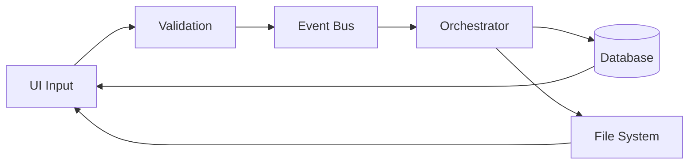

# Data Models - Orchestrator Desktop App

**Project:** unified-app  
**Document ID:** TECH-004  
**Last Updated:** 2026-03-14  
**Status:** Active

---

## 1. Purpose

This document defines all data models, structures, and schemas used in the Orchestrator Desktop App.

---

## 2. Database Schema

### 2.1 Tasks Table

**Purpose:** Store task execution history

**Schema:**
```sql
CREATE TABLE IF NOT EXISTS tasks (
    id INTEGER PRIMARY KEY AUTOINCREMENT,
    description TEXT NOT NULL,
    domain TEXT,
    plan TEXT,
    outcome TEXT,
    error TEXT,
    start_time TIMESTAMP,
    end_time TIMESTAMP
);

CREATE INDEX IF NOT EXISTS idx_description ON tasks(description);
CREATE INDEX IF NOT EXISTS idx_start_time ON tasks(start_time DESC);
```

**Fields:**

| Field | Type | Nullable | Description |
|-------|------|----------|-------------|
| `id` | INTEGER | No | Auto-increment primary key |
| `description` | TEXT | No | Task description (1-1000 chars) |
| `domain` | TEXT | Yes | Domain: browser, desktop, auto-detect |
| `plan` | TEXT | Yes | JSON-encoded execution plan |
| `outcome` | TEXT | Yes | success, failure, cancelled |
| `error` | TEXT | Yes | Error message if failed |
| `start_time` | TIMESTAMP | Yes | Execution start time |
| `end_time` | TIMESTAMP | Yes | Execution end time |

**Indexes:**
- `idx_description`: For search queries
- `idx_start_time`: For sorting by most recent

**Example Record:**
```json
{
    "id": 1,
    "description": "Open Google and search for Python tutorials",
    "domain": "browser",
    "plan": "[\"Launch browser\", \"Navigate to Google\", \"Search for Python tutorials\"]",
    "outcome": "success",
    "error": null,
    "start_time": "2026-03-14 10:30:00",
    "end_time": "2026-03-14 10:30:45"
}
```

---

## 3. Python Data Classes

### 3.1 StartupConfig

**Purpose:** Resolved runtime configuration for startup

**Definition:**
```python
@dataclass(slots=True)
class StartupConfig:
    mode: str              # "live" or "mock"
    api_key: str | None    # Gemini API key
    key_source: str        # "environment", ".env", or "missing"
    env_path: str | None   # Path to .env file
```

**Usage:** Created during startup to determine mode

**Location:** `main.py`

---

### 3.2 StartupReadiness

**Purpose:** Startup verdict for UI state

**Definition:**
```python
@dataclass(slots=True)
class StartupReadiness:
    mode: str                    # "live" or "mock"
    ready: bool                  # Can submit tasks
    user_message: str            # Status message for user
    block_task_submission: bool  # Disable submit button
```

**Usage:** Applied to UI to enable/disable task submission

**Location:** `main.py`

---

## 4. Event Data Structures

### 4.1 Task Submitted Event

**Signal:** `task_submitted(task_description: str, domain: str)`

**Parameters:**
- `task_description`: User-entered task (1-1000 chars)
- `domain`: Selected domain (browser, desktop, auto-detect)

**Example:**
```python
event_bus.task_submitted.emit(
    "Open Google and search for Python",
    "browser"
)
```

---

### 4.2 Plan Generated Event

**Signal:** `plan_generated(plan: List[str])`

**Parameters:**
- `plan`: List of step descriptions

**Example:**
```python
event_bus.plan_generated.emit([
    "Launch browser",
    "Navigate to Google",
    "Search for Python"
])
```

---

### 4.3 Step Events

**Signals:**
- `step_started(index: int, description: str)`
- `step_completed(index: int, payload: dict)`
- `step_failed(index: int, message: str)`

**Parameters:**
- `index`: Step number (0-based)
- `description`: Step description
- `payload`: Result data (dict)
- `message`: Error message

**Example:**
```python
event_bus.step_started.emit(0, "Launch browser")
event_bus.step_completed.emit(0, {"status": "success"})
```

---

### 4.4 Execution Complete Event

**Signal:** `execution_complete(payload: dict)`

**Payload Structure:**
```python
{
    "task_id": int,
    "outcome": str,  # "success", "failure", "cancelled"
    "error": str | None,
    "duration": float  # seconds
}
```

**Example:**
```python
event_bus.execution_complete.emit({
    "task_id": 1,
    "outcome": "success",
    "error": None,
    "duration": 45.2
})
```

---

### 4.5 Frame Captured Event

**Signal:** `frame_captured(file_path: str)`

**Parameters:**
- `file_path`: Absolute path to screenshot file

**Example:**
```python
event_bus.frame_captured.emit(
    "C:/path/to/_runtime/screenshots/screenshot_browser-obj-123456_end.jpg"
)
```

---

### 4.6 Status Update Event

**Signal:** `status_update(message: str, severity: str)`

**Parameters:**
- `message`: Status message text
- `severity`: "info", "warning", "error"

**Example:**
```python
event_bus.status_update.emit("Task submitted", "info")
event_bus.status_update.emit("Step failed", "error")
```

---

## 5. Configuration Data

### 5.1 QSettings Keys

**Storage:** Platform-specific (Windows Registry)

**Keys:**

| Key | Type | Default | Description |
|-----|------|---------|-------------|
| `api_key` | string | "" | Gemini API key |
| `timeout` | int | 30 | Request timeout (seconds) |
| `retry_count` | int | 3 | Number of retries |
| `domain_default` | string | "auto-detect" | Default domain |
| `max_frames` | int | 100 | Maximum screenshot frames |
| `fps_limit` | int | 30 | Frame rate limit |

**Access:**
```python
from PyQt6.QtCore import QSettings
settings = QSettings("Organization", "unified-app")
api_key = settings.value("api_key", "")
settings.setValue("api_key", "new_key")
```

---

### 5.2 Environment Variables

**Variables:**

| Variable | Type | Default | Description |
|----------|------|---------|-------------|
| `GEMINI_API_KEY` | string | None | Gemini API key |
| `GEMINI_MOCK` | string | None | Enable mock mode (1 = enabled) |

**Loading:**
```python
import os
from dotenv import load_dotenv

load_dotenv('.env', override=False)
api_key = os.getenv('GEMINI_API_KEY')
mock_mode = os.getenv('GEMINI_MOCK') == '1'
```

---

## 6. File System Data

### 6.1 Screenshot Files

**Location:** `_runtime/screenshots/`

**Naming Pattern:** `screenshot_{domain}-obj-{timestamp}_{stage}.jpg`

**Example:** `screenshot_browser-obj-184520_end.jpg`

**Metadata:**
- Domain: browser, desktop
- Timestamp: Unix timestamp
- Stage: start, end, intermediate

**Format:** JPEG image

---

### 6.2 Database File

**Location:** `_runtime/history.db`

**Format:** SQLite3 database

**Size:** Grows with task history (~1KB per task)

**Backup:** Manual file copy

---

### 6.3 .env File

**Location:** `unified-app/.env`

**Format:** Key-value pairs

**Example:**
```
GEMINI_MOCK=1
GEMINI_API_KEY=your_api_key_here
```

**Loading:** python-dotenv

---

## 7. JSON Data Structures

### 7.1 Execution Plan (stored in database)

**Format:** JSON array of strings

**Example:**
```json
[
    "Launch browser",
    "Navigate to Google",
    "Enter search query: Python tutorials",
    "Click search button",
    "Review results"
]
```

**Storage:** TEXT field in database (JSON-encoded)

**Parsing:**
```python
import json
plan = json.loads(task_record['plan'])
```

---

### 7.2 Frame Metadata

**Format:** Python dict

**Structure:**
```python
{
    "width": int,        # Image width in pixels
    "height": int,       # Image height in pixels
    "size_bytes": int,   # File size in bytes
    "fps": float         # Calculated FPS
}
```

**Example:**
```python
{
    "width": 1920,
    "height": 1080,
    "size_bytes": 245678,
    "fps": 2.5
}
```

**Usage:** Displayed in GlassBoxPanel metadata section

---

## 8. UI State Models

### 8.1 Execution State

**States:**
- `idle`: No task executing, submit enabled
- `executing`: Task in progress, submit disabled, cancel enabled
- `blocked`: Startup failed, submit disabled

**Transitions:**
```
idle → executing (task submitted)
executing → idle (task complete/cancelled)
blocked → idle (configuration fixed)
```

**Implementation:** Boolean flags in TaskInputPanel

---

### 8.2 Step Status

**States:**
- `pending`: Not started yet
- `running`: Currently executing
- `completed`: Successfully finished
- `failed`: Execution failed

**Visual Indicators:**
- pending: Gray
- running: Blue
- completed: Green
- failed: Red

**Implementation:** QLabel styling in ExecutionPlanPanel

---

## 9. Data Validation Rules

### 9.1 Task Description
- **Type:** string
- **Min Length:** 1 character
- **Max Length:** 1000 characters
- **Allowed:** All UTF-8 characters
- **Validation:** Non-empty, length check

---

### 9.2 Domain
- **Type:** enum
- **Values:** "auto-detect", "browser", "desktop"
- **Default:** "auto-detect"
- **Validation:** Must be one of allowed values

---

### 9.3 Timeout
- **Type:** integer
- **Min:** 1 second
- **Max:** 300 seconds
- **Default:** 30 seconds
- **Validation:** Range check

---

### 9.4 Retry Count
- **Type:** integer
- **Min:** 0
- **Max:** 10
- **Default:** 3
- **Validation:** Range check

---

### 9.5 Frame Limits
- **Type:** integer
- **Min:** 1
- **Max:** 1000
- **Default:** 100
- **Validation:** Positive integer

---

## 10. Data Flow Diagram



---

## 11. Data Persistence

### 11.1 Persistent Data
- Task history (SQLite)
- Settings (QSettings)
- Screenshots (File system)

### 11.2 Session Data
- Current execution state
- Event bus state
- UI state

### 11.3 Transient Data
- Event payloads
- Temporary variables
- Cache data

---

## 12. Data Security

### 12.1 Sensitive Data
- API key (masked in UI, stored in QSettings)

### 12.2 User Data
- Task descriptions (stored in database)
- Execution history (stored in database)

### 12.3 System Data
- Screenshots (stored in file system)
- Logs (in-memory, not persisted)

---

## References

- System Architecture: `system-architecture.md`
- Integration Requirements: `integration-requirements.md`
- Database Schema: Section 2 of this document
- Event Definitions: `orchestrator/event_bus.py`
