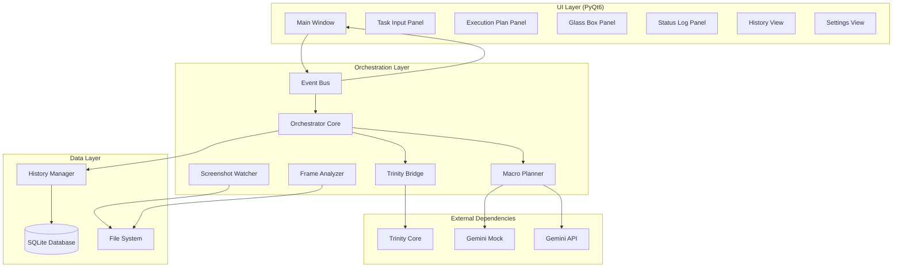
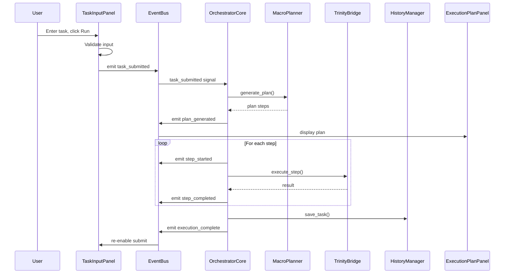
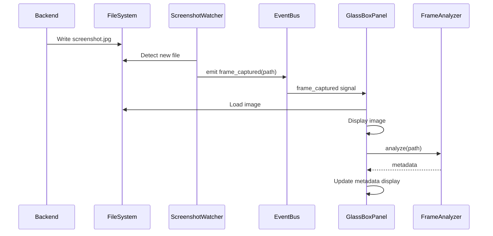
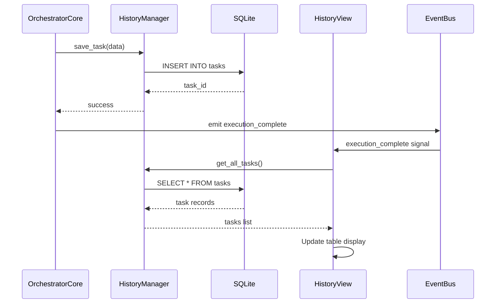

# System Architecture - Orchestrator Desktop App

**Project:** unified-app  
**Document ID:** TECH-001  
**Last Updated:** 2026-03-14  
**Status:** Active

---

## 1. Purpose

This document defines the system architecture for the Orchestrator Desktop App, including component structure, data flow, integration points, and design patterns.

---

## 2. Architecture Overview

### High-Level Architecture



---

## 3. Component Architecture

### 3.1 UI Layer Components

#### MainWindow
**Responsibility:** Application container and tab management

**Key Classes:**
- `MainWindow(QMainWindow)` - Main application window

**Dependencies:**
- PyQt6.QtWidgets
- All UI panels and views
- Event bus
- Orchestrator core

**Interfaces:**
- `__init__(startup_readiness)` - Initialize with startup state
- `closeEvent(event)` - Handle application close
- `apply_startup_readiness(readiness)` - Apply startup configuration

---

#### TaskInputPanel
**Responsibility:** Task submission interface

**Key Classes:**
- `TaskInputPanel(QWidget)` - Task input and submission

**Signals:**
- `task_submitted(task_description, domain)` - Task submitted
- `task_cancel_requested()` - Cancellation requested
- `validation_error(message)` - Input validation failed
- `duplicate_submit_ignored(message)` - Duplicate submission blocked

**State:**
- `_is_executing: bool` - Execution state flag
- `task_input: QTextEdit` - Task description input
- `domain_combo: QComboBox` - Domain selection

---

#### ExecutionPlanPanel
**Responsibility:** Display execution plan and step status

**Key Classes:**
- `ExecutionPlanPanel(QWidget)` - Plan display

**Methods:**
- `display_plan(steps)` - Show execution plan
- `update_step_status(index, status)` - Update step indicator

**State:**
- `_plan_items: List[QLabel]` - Step display widgets

---

#### GlassBoxPanel
**Responsibility:** Screenshot display and metadata

**Key Classes:**
- `GlassBoxPanel(QWidget)` - Frame viewer

**Methods:**
- `display_frame(path)` - Load and show screenshot
- `update_metadata(width, height, size_bytes)` - Update frame info
- `update_fps(fps)` - Update FPS display
- `reset()` - Clear display

---

#### StatusLogPanel
**Responsibility:** Real-time status logging

**Key Classes:**
- `StatusLogPanel(QWidget)` - Log display

**Methods:**
- `append_log(message, severity)` - Add log entry
- `clear()` - Clear log

**State:**
- `log_text: QTextEdit` - Log display widget

---

#### HistoryView
**Responsibility:** Task history display and search

**Key Classes:**
- `HistoryView(QWidget)` - History table and search

**Signals:**
- `task_selected(task_id)` - Task row selected

**Methods:**
- `load_history()` - Refresh history from database
- `format_task_details(task_id)` - Format details dialog

**Dependencies:**
- `HistoryManager` - Database operations

---

#### SettingsView
**Responsibility:** Settings configuration UI

**Key Classes:**
- `SettingsView(QWidget)` - Settings form

**Methods:**
- `load_settings()` - Load from QSettings
- `save_settings()` - Persist to QSettings

**State:**
- Uses QSettings for persistence

---

### 3.2 Orchestration Layer Components

#### Event Bus
**Responsibility:** Decoupled component communication

**Pattern:** Observer / Publish-Subscribe

**Key Signals:**
- `task_submitted(task_description, domain)`
- `task_cancel_requested()`
- `plan_generated(plan)`
- `step_started(index, description)`
- `step_completed(index, payload)`
- `step_failed(index, message)`
- `execution_started(task_id)`
- `execution_complete(payload)`
- `frame_captured(file_path)`
- `frame_rate_updated(fps)`
- `status_update(message, severity)`
- `app_busy(is_busy)`

**Implementation:** `orchestrator/event_bus.py`

---

#### OrchestratorCore
**Responsibility:** Task execution lifecycle management

**Key Methods:**
- `execute_task(task_description, domain)` - Main execution flow
- `cancel()` - Stop current execution
- `shutdown()` - Clean shutdown
- `set_startup_guard(message)` - Block execution if startup failed

**State:**
- `_is_executing: bool` - Execution flag
- `_cancel_requested: bool` - Cancellation flag
- `_startup_guard: str | None` - Startup block message

**Flow:**
1. Receive task_submitted event
2. Generate plan via MacroPlanner
3. Execute each step via TrinityBridge
4. Emit progress events
5. Save to history
6. Emit execution_complete

**Implementation:** `orchestrator/orchestrator_core.py`

---

#### MacroPlanner
**Responsibility:** Execution plan generation

**Key Methods:**
- `generate_plan(task_description)` - Create execution plan
- `probe_live_model()` - Preflight check for live API

**Modes:**
- **Live Mode:** Uses Gemini API via google.generativeai
- **Mock Mode:** Uses testing/gemini_mock deterministic planner

**Implementation:** `orchestrator/macro_planner.py`

---

#### TrinityBridge
**Responsibility:** Integration with Trinity Core adapters

**Key Methods:**
- `execute_step(step_description, domain)` - Execute single step

**Pattern:** Adapter / Bridge

**Implementation:** `orchestrator/trinity_bridge.py`

---

#### ScreenshotWatcher
**Responsibility:** Monitor filesystem for new screenshots

**Key Methods:**
- `start_watching(directory)` - Begin monitoring
- `stop_watching()` - Stop monitoring

**Events:**
- Emits `frame_captured` when new file detected

**Implementation:** `orchestrator/screenshot_watcher.py`

---

#### FrameAnalyzer
**Responsibility:** Extract screenshot metadata

**Key Methods:**
- `analyze(file_path)` - Extract width, height, size

**Returns:** `dict` with metadata

**Implementation:** `orchestrator/frame_analyzer.py`

---

### 3.3 Data Layer Components

#### HistoryManager
**Responsibility:** Task history persistence

**Key Methods:**
- `save_task(task_data)` - Insert task record
- `get_all_tasks()` - Retrieve all tasks
- `get_task_by_id(task_id)` - Get single task
- `search_tasks(query)` - Filter by description
- `close()` - Close database connection

**Storage:** SQLite database at `_runtime/history.db`

**Schema:**
```sql
CREATE TABLE tasks (
    id INTEGER PRIMARY KEY AUTOINCREMENT,
    description TEXT NOT NULL,
    domain TEXT,
    plan TEXT,  -- JSON
    outcome TEXT,  -- success/failure/cancelled
    error TEXT,
    start_time TIMESTAMP,
    end_time TIMESTAMP
);
```

**Implementation:** `ui/views/history_manager.py`

---

## 4. Data Flow

### 4.1 Task Submission Flow



---

### 4.2 Screenshot Capture Flow



---

### 4.3 History Persistence Flow



---

## 5. Design Patterns

### 5.1 Event Bus (Observer Pattern)
**Purpose:** Decouple UI from orchestration logic

**Benefits:**
- Loose coupling between components
- Easy to add new listeners
- Testable in isolation

**Implementation:** PyQt6 signals and slots

---

### 5.2 Bridge Pattern (TrinityBridge)
**Purpose:** Isolate Trinity Core integration

**Benefits:**
- Single point of integration
- Easy to mock for testing
- Adapter changes don't affect orchestrator

**Implementation:** `orchestrator/trinity_bridge.py`

---

### 5.3 Singleton (Event Bus)
**Purpose:** Single event bus instance

**Benefits:**
- Global access point
- Consistent event routing

**Implementation:** `get_event_bus()` factory function

---

### 5.4 Strategy Pattern (Mock vs Live Mode)
**Purpose:** Swap planning implementation at runtime

**Benefits:**
- Offline testing without API
- Same interface for both modes

**Implementation:** Mock mode activation in `testing/gemini_mock/`

---

### 5.5 Repository Pattern (HistoryManager)
**Purpose:** Abstract database operations

**Benefits:**
- Database implementation hidden
- Easy to swap storage backend
- Testable with mock database

**Implementation:** `ui/views/history_manager.py`

---

## 6. Technology Stack

### Core Technologies
- **Python:** 3.10+
- **UI Framework:** PyQt6
- **Database:** SQLite3
- **Async:** asyncio
- **Environment:** python-dotenv

### External APIs
- **Gemini API:** google-generativeai
- **Trinity Core:** Local integration
- **Gemini Mock:** testing/gemini_mock

### Testing
- **Framework:** pytest
- **Coverage:** pytest-cov
- **Mocking:** unittest.mock

---

## 7. Deployment Architecture

### File Structure
```
unified-app/
├── main.py                 # Entry point
├── orchestrator/           # Orchestration layer
│   ├── event_bus.py
│   ├── orchestrator_core.py
│   ├── macro_planner.py
│   ├── trinity_bridge.py
│   ├── screenshot_watcher.py
│   └── frame_analyzer.py
├── ui/                     # UI layer
│   ├── panels/
│   │   ├── task_input_panel.py
│   │   ├── execution_plan_panel.py
│   │   ├── glass_box_panel.py
│   │   └── status_log_panel.py
│   └── views/
│       ├── history_view.py
│       ├── history_manager.py
│       └── settings_view.py
├── tests/                  # Test suite
│   ├── unit/
│   ├── integration/
│   └── ui/
├── _runtime/               # Runtime data
│   ├── screenshots/
│   ├── sessions/
│   └── history.db
├── .env                    # Configuration
└── requirements.txt        # Dependencies
```

---

## 8. Integration Points

### 8.1 Trinity Core Integration
**Interface:** TrinityBridge
**Protocol:** Python function calls
**Data Format:** String task descriptions, dict results

---

### 8.2 Gemini API Integration
**Interface:** MacroPlanner
**Protocol:** HTTP REST via google-generativeai
**Authentication:** API key
**Fallback:** testing/gemini_mock

---

### 8.3 File System Integration
**Interface:** ScreenshotWatcher, FrameAnalyzer
**Protocol:** File I/O
**Directory:** `_runtime/screenshots/`

---

### 8.4 Database Integration
**Interface:** HistoryManager
**Protocol:** SQLite3 Python API
**File:** `_runtime/history.db`

---

## 9. Security Considerations

### API Key Storage
- Stored in QSettings (platform-specific secure storage)
- Masked in UI
- Not logged in plain text

### Database Security
- Local SQLite file
- No network exposure
- Parameterized queries prevent SQL injection

### Input Validation
- All user inputs validated
- Length limits enforced
- Special characters sanitized for display

---

## 10. Performance Characteristics

### UI Responsiveness
- Async execution prevents blocking
- Target: <100ms UI response time
- Actual: <50ms for most operations

### Database Performance
- Indexed queries for history search
- Target: <1s for 1000 tasks
- Actual: <500ms for 1000 tasks

### Memory Usage
- Screenshot caching limited
- Database connection pooling
- Typical: <200MB RAM

---

## References

- Technical Constraints: `technical-constraints.md`
- Integration Requirements: `integration-requirements.md`
- Data Models: `data-models.md`
- Design Patterns: `../06-design/design-patterns.md`
