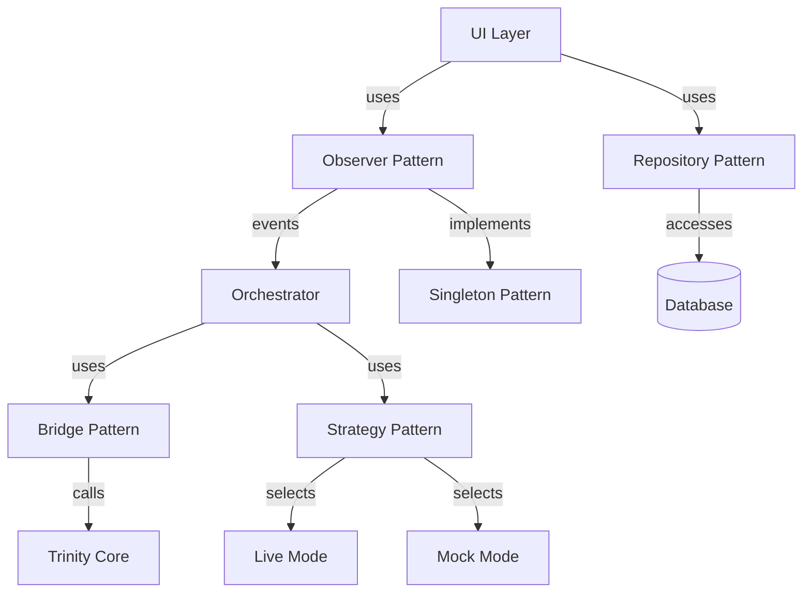

# Design Patterns - Orchestrator Desktop App

**Project:** unified-app  
**Document ID:** DES-001  
**Last Updated:** 2026-03-14  
**Status:** Active

---

## 1. Purpose

This document catalogs all design patterns used in the Orchestrator Desktop App, explaining their purpose, implementation, and benefits.

---

## 2. Pattern Overview

| Pattern | Category | Usage | Status |
|---------|----------|-------|--------|
| Observer (Event Bus) | Behavioral | Component communication | ✅ Implemented |
| Bridge | Structural | Trinity Core integration | ✅ Implemented |
| Repository | Structural | Data access abstraction | ✅ Implemented |
| Strategy | Behavioral | Mock vs Live mode | ✅ Implemented |
| Singleton | Creational | Event bus instance | ✅ Implemented |
| Model-View | Architectural | UI separation | ✅ Implemented |

---

## 3. P1: Observer Pattern (Event Bus)

### Purpose
Decouple UI components from orchestration logic, enabling loose coupling and independent evolution.

### Problem Solved
- UI needs to react to orchestration events
- Orchestrator shouldn't know about UI
- Multiple components need same events
- Adding new listeners shouldn't require changes

### Implementation

**EventBus Class:**
```python
from PyQt6.QtCore import QObject, pyqtSignal

class EventBus(QObject):
    # Task lifecycle events
    task_submitted = pyqtSignal(str, str)  # description, domain
    execution_complete = pyqtSignal(dict)  # payload
    
    # Plan events
    plan_generated = pyqtSignal(list)  # steps
    step_started = pyqtSignal(int, str)  # index, description
    step_completed = pyqtSignal(int, dict)  # index, payload
    step_failed = pyqtSignal(int, str)  # index, error
    
    # UI events
    app_busy = pyqtSignal(bool)  # is_busy
    status_update = pyqtSignal(str, str)  # message, severity
    
    # Frame events
    frame_captured = pyqtSignal(str)  # file_path
    frame_rate_updated = pyqtSignal(float)  # fps

# Singleton access
_event_bus = None

def get_event_bus() -> EventBus:
    global _event_bus
    if _event_bus is None:
        _event_bus = EventBus()
    return _event_bus
```

**Usage - Emitting Events:**
```python
bus = get_event_bus()
bus.task_submitted.emit(task_description, domain)
```

**Usage - Listening to Events:**
```python
bus = get_event_bus()
bus.task_submitted.connect(self.on_task_submitted)
```

### Benefits
- **Loose Coupling:** Components don't know about each other
- **Extensibility:** Easy to add new listeners
- **Testability:** Can test components in isolation
- **Thread Safety:** Qt signals are thread-safe

### Trade-offs
- **Indirection:** Event flow less obvious than direct calls
- **Debugging:** Harder to trace event propagation

### Status
✅ Fully implemented in `orchestrator/event_bus.py`

---

## 4. P2: Bridge Pattern

### Purpose
Isolate Trinity Core integration, allowing adapter changes without affecting orchestrator.

### Problem Solved
- Trinity Core is external dependency
- Adapter interface may change
- Need to mock for testing
- Want single integration point

### Implementation

**TrinityBridge Class:**
```python
class TrinityBridge:
    """Bridge to Trinity Core adapters"""
    
    def __init__(self):
        self._trinity = None  # Lazy initialization
    
    def execute_step(self, step_description: str, domain: str) -> dict:
        """Execute single step via Trinity Core
        
        Args:
            step_description: What to do
            domain: Which adapter to use
            
        Returns:
            Result dictionary
        """
        # Initialize Trinity if needed
        if self._trinity is None:
            from trinity_core import Trinity
            self._trinity = Trinity()
        
        # Route to appropriate adapter
        if domain == "browser":
            return self._trinity.browser_adapter.execute(step_description)
        elif domain == "desktop":
            return self._trinity.desktop_adapter.execute(step_description)
        else:
            return self._trinity.auto_detect(step_description)
```

**Usage:**
```python
bridge = TrinityBridge()
result = bridge.execute_step("Open Google", "browser")
```

### Benefits
- **Isolation:** Trinity changes don't affect orchestrator
- **Testability:** Easy to mock TrinityBridge
- **Single Point:** One place to modify integration
- **Flexibility:** Can swap Trinity implementation

### Trade-offs
- **Indirection:** Extra layer between orchestrator and Trinity
- **Performance:** Minimal overhead from abstraction

### Status
✅ Fully implemented in `orchestrator/trinity_bridge.py`

---

## 5. P3: Repository Pattern

### Purpose
Abstract database operations, hiding SQLite implementation details.

### Problem Solved
- UI shouldn't know about database
- Want to swap database backend later
- Need consistent data access interface
- Testing requires mock database

### Implementation

**HistoryManager Class:**
```python
class HistoryManager:
    """Repository for task history"""
    
    def __init__(self, db_path: str = "_runtime/history.db"):
        self._conn = sqlite3.connect(db_path)
        self._create_schema()
    
    def save_task(self, task_data: dict) -> int:
        """Save task to database
        
        Args:
            task_data: Task information
            
        Returns:
            Task ID
        """
        with self._conn:
            cursor = self._conn.cursor()
            cursor.execute(
                "INSERT INTO tasks (description, domain, plan, outcome) "
                "VALUES (?, ?, ?, ?)",
                (task_data['description'], task_data['domain'],
                 json.dumps(task_data['plan']), task_data['outcome'])
            )
            return cursor.lastrowid
    
    def get_all_tasks(self) -> List[dict]:
        """Retrieve all tasks"""
        cursor = self._conn.cursor()
        cursor.execute("SELECT * FROM tasks ORDER BY start_time DESC")
        return [self._row_to_dict(row) for row in cursor.fetchall()]
    
    def search_tasks(self, query: str) -> List[dict]:
        """Search tasks by description"""
        cursor = self._conn.cursor()
        cursor.execute(
            "SELECT * FROM tasks WHERE description LIKE ? "
            "ORDER BY start_time DESC",
            (f"%{query}%",)
        )
        return [self._row_to_dict(row) for row in cursor.fetchall()]
```

**Usage:**
```python
history = HistoryManager()
task_id = history.save_task(task_data)
tasks = history.get_all_tasks()
```

### Benefits
- **Abstraction:** Database details hidden
- **Testability:** Can use in-memory database for tests
- **Flexibility:** Can swap SQLite for PostgreSQL
- **Consistency:** Single place for data access logic

### Trade-offs
- **Complexity:** Extra layer of abstraction
- **Performance:** Minimal overhead

### Status
✅ Fully implemented in `ui/views/history_manager.py`

---

## 6. P4: Strategy Pattern

### Purpose
Swap planning implementation at runtime (live vs mock mode).

### Problem Solved
- Need offline testing without API
- Want same interface for both modes
- Runtime mode selection
- No code changes between modes

### Implementation

**Mock Mode Activation:**
```python
# testing/gemini_mock/activator.py
def activate_mock_mode():
    """Replace google.generativeai with mock"""
    import sys
    from . import mock_genai
    sys.modules['google.generativeai'] = mock_genai
```

**MacroPlanner (works with both):**
```python
class MacroPlanner:
    def generate_plan(self, task_description: str) -> List[str]:
        """Generate plan using current mode
        
        Uses google.generativeai module, which may be:
        - Real Gemini API (live mode)
        - Mock implementation (mock mode)
        """
        import google.generativeai as genai
        
        model = genai.GenerativeModel('gemini-pro')
        response = model.generate_content(prompt)
        return self._parse_plan(response.text)
```

**Mode Selection:**
```python
# main.py
if os.getenv('GEMINI_MOCK') == '1':
    from testing.gemini_mock import activate_mock_mode
    activate_mock_mode()
```

### Benefits
- **Flexibility:** Switch modes without code changes
- **Testability:** All tests run in mock mode
- **Offline Development:** No API key needed
- **Same Interface:** MacroPlanner code unchanged

### Trade-offs
- **Module Patching:** Somewhat magical
- **Import Order:** Must activate before importing MacroPlanner

### Status
✅ Fully implemented in `testing/gemini_mock/`

---

## 7. P5: Singleton Pattern

### Purpose
Ensure single EventBus instance shared across application.

### Problem Solved
- Multiple EventBus instances would miss events
- Need global access point
- Want consistent event routing

### Implementation

```python
# orchestrator/event_bus.py
_event_bus = None

def get_event_bus() -> EventBus:
    """Get singleton EventBus instance"""
    global _event_bus
    if _event_bus is None:
        _event_bus = EventBus()
    return _event_bus
```

**Usage:**
```python
from orchestrator.event_bus import get_event_bus

bus = get_event_bus()  # Always same instance
bus.task_submitted.connect(handler)
```

### Benefits
- **Single Instance:** All components use same bus
- **Global Access:** Available anywhere
- **Lazy Initialization:** Created on first use

### Trade-offs
- **Global State:** Can make testing harder
- **Hidden Dependencies:** Not obvious from function signatures

### Mitigation
- Tests can reset singleton if needed
- Factory function makes dependency explicit

### Status
✅ Fully implemented in `orchestrator/event_bus.py`

---

## 8. P6: Model-View Pattern

### Purpose
Separate UI presentation from data and logic.

### Problem Solved
- UI shouldn't contain business logic
- Data access shouldn't know about UI
- Want to test logic without UI

### Implementation

**Model (HistoryManager):**
```python
class HistoryManager:
    """Data access - no UI knowledge"""
    def get_all_tasks(self) -> List[dict]:
        return self._query_database()
```

**View (HistoryView):**
```python
class HistoryView(QWidget):
    """UI presentation - uses model"""
    def __init__(self):
        self._history_manager = HistoryManager()
        self._setup_ui()
    
    def load_history(self):
        """Load data from model and display"""
        tasks = self._history_manager.get_all_tasks()
        self._populate_table(tasks)
```

### Benefits
- **Separation:** UI and data independent
- **Testability:** Can test model without UI
- **Flexibility:** Can change UI without affecting data
- **Reusability:** Model can be used by different views

### Trade-offs
- **Complexity:** More classes and files
- **Boilerplate:** Some code to wire model and view

### Status
✅ Implemented throughout UI layer

---

## 9. Additional Patterns

### P7: Factory Pattern (Lightweight)

**Usage:** `get_event_bus()` factory function

**Purpose:** Encapsulate EventBus creation

**Status:** ✅ Implemented

---

### P8: Template Method (Implicit)

**Usage:** QWidget subclasses override specific methods

**Example:**
```python
class TaskInputPanel(QWidget):
    def __init__(self):
        super().__init__()
        self._setup_ui()  # Template method
```

**Status:** ✅ Used in UI components

---

### P9: Dependency Injection (Lightweight)

**Usage:** Pass dependencies to constructors

**Example:**
```python
class MainWindow(QMainWindow):
    def __init__(self, startup_readiness: StartupReadiness):
        self._readiness = startup_readiness
```

**Status:** ✅ Used where appropriate

---

## 10. Pattern Selection Rationale

### Why Observer (Event Bus)?
- **Need:** Decouple UI from orchestration
- **Alternative:** Direct method calls (tight coupling)
- **Choice:** Observer for loose coupling

### Why Bridge?
- **Need:** Isolate Trinity Core integration
- **Alternative:** Direct Trinity calls (hard to test)
- **Choice:** Bridge for testability

### Why Repository?
- **Need:** Abstract database access
- **Alternative:** Direct SQL in UI (mixing concerns)
- **Choice:** Repository for separation

### Why Strategy?
- **Need:** Swap planning modes
- **Alternative:** If/else everywhere (duplication)
- **Choice:** Strategy for clean switching

### Why Singleton?
- **Need:** Single EventBus instance
- **Alternative:** Pass EventBus everywhere (tedious)
- **Choice:** Singleton for convenience

### Why Model-View?
- **Need:** Separate UI from data
- **Alternative:** UI with embedded SQL (mixing concerns)
- **Choice:** Model-View for separation

---

## 11. Anti-Patterns Avoided

### ❌ God Object
**Avoided by:** Separation of concerns, focused classes

### ❌ Spaghetti Code
**Avoided by:** Clear architecture, event bus

### ❌ Tight Coupling
**Avoided by:** Observer, Bridge, Repository patterns

### ❌ Hardcoded Dependencies
**Avoided by:** Dependency injection, factory functions

### ❌ Magic Numbers
**Avoided by:** Named constants, configuration

---

## 12. Pattern Interactions



---

## 13. Pattern Benefits Summary

| Pattern | Primary Benefit | Secondary Benefit |
|---------|----------------|-------------------|
| Observer | Loose coupling | Extensibility |
| Bridge | Isolation | Testability |
| Repository | Abstraction | Flexibility |
| Strategy | Runtime selection | Testability |
| Singleton | Single instance | Global access |
| Model-View | Separation | Testability |

---

## 14. Pattern Testing

### Observer Pattern Tests
- Event emission and reception
- Multiple listeners
- Event ordering

**Location:** `tests/unit/test_event_bus.py`

### Bridge Pattern Tests
- Step execution
- Error handling
- Mock integration

**Location:** `tests/unit/test_trinity_bridge.py`

### Repository Pattern Tests
- CRUD operations
- Search functionality
- Transaction handling

**Location:** `tests/unit/test_history_manager.py`

### Strategy Pattern Tests
- Mock mode activation
- Live mode operation
- Mode switching

**Location:** `tests/integration/test_mock_mode.py`

---

## 15. Future Pattern Opportunities

### If Adding Plugin System
- **Plugin Pattern:** Load external modules
- **Registry Pattern:** Track available plugins

### If Adding Undo/Redo
- **Command Pattern:** Encapsulate actions
- **Memento Pattern:** Save state

### If Adding Caching
- **Proxy Pattern:** Lazy loading
- **Decorator Pattern:** Add caching layer

**Note:** Not needed for current scope

---

## References

- System Architecture: `../04-technical/system-architecture.md`
- Implementation: Source code in respective modules
- Gang of Four: Design Patterns book
- PyQt6 Patterns: Qt documentation
