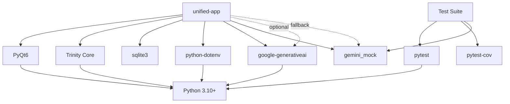

# Dependencies - Orchestrator Desktop App

**Project:** unified-app  
**Document ID:** PROJ-003  
**Last Updated:** 2026-03-14  
**Status:** Active

---

## 1. Purpose

This document catalogs all dependencies for the Orchestrator Desktop App, including external libraries, internal modules, and environmental requirements.

---

## 2. External Dependencies

### 2.1 Python Runtime

**Dependency:** Python  
**Version:** 3.10 or higher  
**Type:** Critical  
**Rationale:** Trinity Core requires Python 3.10+ features  
**Source:** python.org  
**License:** PSF License

**Installation:**
```bash
# Windows
python --version  # Verify 3.10+
```

**Status:** ✅ Required and available

---

### 2.2 PyQt6

**Dependency:** PyQt6  
**Version:** ≥6.4.0  
**Type:** Critical  
**Rationale:** UI framework  
**Source:** PyPI  
**License:** GPL v3 / Commercial

**Installation:**
```bash
pip install PyQt6>=6.4.0
```

**Modules Used:**
- PyQt6.QtWidgets
- PyQt6.QtCore
- PyQt6.QtGui

**Status:** ✅ Installed and tested

---

### 2.3 Google Generative AI

**Dependency:** google-generativeai  
**Version:** ≥0.3.0  
**Type:** Optional (mock mode available)  
**Rationale:** Gemini API for plan generation  
**Source:** PyPI  
**License:** Apache 2.0

**Installation:**
```bash
pip install google-generativeai>=0.3.0
```

**Usage:** MacroPlanner in live mode

**Status:** ✅ Installed, mock mode available

---

### 2.4 Python-dotenv

**Dependency:** python-dotenv  
**Version:** ≥1.0.0  
**Type:** Important  
**Rationale:** Environment variable management  
**Source:** PyPI  
**License:** BSD-3-Clause

**Installation:**
```bash
pip install python-dotenv>=1.0.0
```

**Usage:** Load .env configuration

**Status:** ✅ Installed

---

### 2.5 Pytest

**Dependency:** pytest  
**Version:** ≥7.4.0  
**Type:** Development  
**Rationale:** Testing framework  
**Source:** PyPI  
**License:** MIT

**Installation:**
```bash
pip install pytest>=7.4.0
```

**Usage:** All automated tests

**Status:** ✅ Installed

---

### 2.6 Pytest-cov

**Dependency:** pytest-cov  
**Version:** ≥4.1.0  
**Type:** Development  
**Rationale:** Code coverage reporting  
**Source:** PyPI  
**License:** MIT

**Installation:**
```bash
pip install pytest-cov>=4.1.0
```

**Usage:** Coverage measurement

**Status:** ✅ Installed

---

### 2.7 SQLite3

**Dependency:** sqlite3  
**Version:** Built-in with Python  
**Type:** Critical  
**Rationale:** Task history database  
**Source:** Python standard library  
**License:** Public Domain

**Installation:** Included with Python

**Usage:** HistoryManager

**Status:** ✅ Built-in

---

## 3. Internal Dependencies

### 3.1 Trinity Core

**Dependency:** Trinity Core  
**Location:** `../../../trinity_core/`  
**Type:** Critical  
**Rationale:** Orchestration engine  
**Interface:** TrinityBridge

**Integration:**
```python
from trinity_core import Trinity
```

**Status:** ✅ Integrated via bridge pattern

---

### 3.2 Gemini Mock

**Dependency:** testing/gemini_mock  
**Location:** `../../../testing/gemini_mock/`  
**Type:** Important  
**Rationale:** Offline testing and development  
**Interface:** Mock google.generativeai module

**Activation:**
```python
from testing.gemini_mock import activate_mock_mode
activate_mock_mode()
```

**Status:** ✅ Integrated and tested

---

## 4. Environmental Dependencies

### 4.1 Operating System

**Dependency:** Windows  
**Version:** Windows 10/11  
**Type:** Critical  
**Rationale:** Development and deployment environment  
**Alternatives:** Linux/macOS untested

**Status:** ✅ Windows 11 tested

---

### 4.2 File System

**Dependency:** Writable file system  
**Type:** Critical  
**Rationale:** Database, screenshots, configuration  
**Paths:**
- `_runtime/history.db`
- `_runtime/screenshots/`
- QSettings (Registry on Windows)

**Status:** ✅ Available

---

### 4.3 Network (Optional)

**Dependency:** Internet connection  
**Type:** Optional  
**Rationale:** Gemini API in live mode  
**Fallback:** Mock mode works offline

**Status:** ✅ Optional (mock mode available)

---

## 5. Development Dependencies

### 5.1 Git

**Dependency:** Git  
**Version:** Any recent version  
**Type:** Development  
**Rationale:** Version control  
**Source:** git-scm.com

**Status:** ✅ Used for version control

---

### 5.2 Code Editor

**Dependency:** Code editor (VS Code, PyCharm, etc.)  
**Type:** Development  
**Rationale:** Code editing  
**Preference:** Any Python-capable editor

**Status:** ✅ Available

---

## 6. Dependency Matrix

| Dependency | Version | Type | License | Status |
|------------|---------|------|---------|--------|
| Python | ≥3.10 | Critical | PSF | ✅ |
| PyQt6 | ≥6.4.0 | Critical | GPL/Commercial | ✅ |
| google-generativeai | ≥0.3.0 | Optional | Apache 2.0 | ✅ |
| python-dotenv | ≥1.0.0 | Important | BSD-3 | ✅ |
| pytest | ≥7.4.0 | Dev | MIT | ✅ |
| pytest-cov | ≥4.1.0 | Dev | MIT | ✅ |
| sqlite3 | Built-in | Critical | Public Domain | ✅ |
| Trinity Core | Local | Critical | N/A | ✅ |
| Gemini Mock | Local | Important | N/A | ✅ |
| Windows | 10/11 | Critical | N/A | ✅ |

---

## 7. Dependency Installation

### 7.1 Requirements File

**File:** `requirements.txt`

**Contents:**
```
PyQt6>=6.4.0
google-generativeai>=0.3.0
python-dotenv>=1.0.0
pytest>=7.4.0
pytest-cov>=4.1.0
```

**Installation:**
```bash
pip install -r requirements.txt
```

---

### 7.2 Installation Order

1. Python 3.10+ (prerequisite)
2. pip (included with Python)
3. requirements.txt dependencies
4. Trinity Core (already in repo)
5. Gemini Mock (already in repo)

**Status:** ✅ Documented in USER_MANUAL.md

---

## 8. Dependency Risks

### 8.1 PyQt6 GPL License

**Risk:** GPL license requires open source if distributed

**Impact:** Cannot distribute commercially without commercial license

**Mitigation:** Academic use only, acceptable

**Status:** ✅ Accepted

---

### 8.2 Gemini API Availability

**Risk:** API may be unavailable or change

**Impact:** Live mode broken

**Mitigation:** Mock mode fallback

**Status:** ✅ Mitigated

---

### 8.3 Trinity Core Changes

**Risk:** Trinity Core interface may change

**Impact:** Integration broken

**Mitigation:** Bridge pattern isolates integration

**Status:** ✅ Mitigated

---

### 8.4 Python Version

**Risk:** Python 3.10+ not available

**Impact:** Cannot run application

**Mitigation:** Document requirement clearly

**Status:** ✅ Documented

---

## 9. Dependency Updates

### 9.1 Update Policy

**Policy:** Use minimum version requirements (>=)

**Rationale:** Allow updates while ensuring compatibility

**Risk:** Breaking changes in updates

**Mitigation:** Test after updates

---

### 9.2 Known Compatible Versions

**Tested Versions:**
- Python 3.10.x
- PyQt6 6.4.x
- google-generativeai 0.3.x
- python-dotenv 1.0.x
- pytest 7.4.x
- pytest-cov 4.1.x

**Status:** ✅ All tested and working

---

## 10. Dependency Alternatives

### 10.1 UI Framework

**Current:** PyQt6  
**Alternatives:** Electron, Tkinter, wxPython  
**Reason for Choice:** Direct Python integration, performance  
**Status:** ✅ Decision final

---

### 10.2 Database

**Current:** SQLite  
**Alternatives:** PostgreSQL, MySQL, JSON files  
**Reason for Choice:** Lightweight, serverless, built-in  
**Status:** ✅ Decision final (Repository pattern allows swap)

---

### 10.3 LLM Provider

**Current:** Gemini API  
**Alternatives:** OpenAI, Claude, Local models  
**Reason for Choice:** Free tier, good performance  
**Status:** ✅ Decision final (mock mode available)

---

## 11. Dependency Graph



---

## 12. Dependency Verification

### 12.1 Verification Commands

**Check Python:**
```bash
python --version  # Should be 3.10+
```

**Check Dependencies:**
```bash
pip list | findstr "PyQt6 google-generativeai python-dotenv pytest"
```

**Check Trinity Core:**
```bash
python -c "from trinity_core import Trinity; print('OK')"
```

**Check Gemini Mock:**
```bash
python -c "from testing.gemini_mock import activate_mock_mode; print('OK')"
```

---

### 12.2 Dependency Health

| Dependency | Installed | Version OK | Working | Status |
|------------|-----------|------------|---------|--------|
| Python | ✅ | ✅ | ✅ | ✅ |
| PyQt6 | ✅ | ✅ | ✅ | ✅ |
| google-generativeai | ✅ | ✅ | ✅ | ✅ |
| python-dotenv | ✅ | ✅ | ✅ | ✅ |
| pytest | ✅ | ✅ | ✅ | ✅ |
| pytest-cov | ✅ | ✅ | ✅ | ✅ |
| sqlite3 | ✅ | ✅ | ✅ | ✅ |
| Trinity Core | ✅ | ✅ | ✅ | ✅ |
| Gemini Mock | ✅ | ✅ | ✅ | ✅ |

**Overall Health:** ✅ All dependencies healthy

---

## 13. Dependency Documentation

### 13.1 User Documentation

**Location:** `docs/USER_MANUAL.md`

**Content:**
- Installation instructions
- Dependency list
- Troubleshooting

**Status:** ✅ Complete

---

### 13.2 Developer Documentation

**Location:** This document

**Content:**
- Complete dependency catalog
- Version requirements
- Installation procedures
- Risk assessment

**Status:** ✅ Complete

---

## References

- Requirements File: `../../requirements.txt`
- User Manual: `../../USER_MANUAL.md`
- Technical Constraints: `../04-technical/technical-constraints.md`
- Integration Requirements: `../04-technical/integration-requirements.md`
